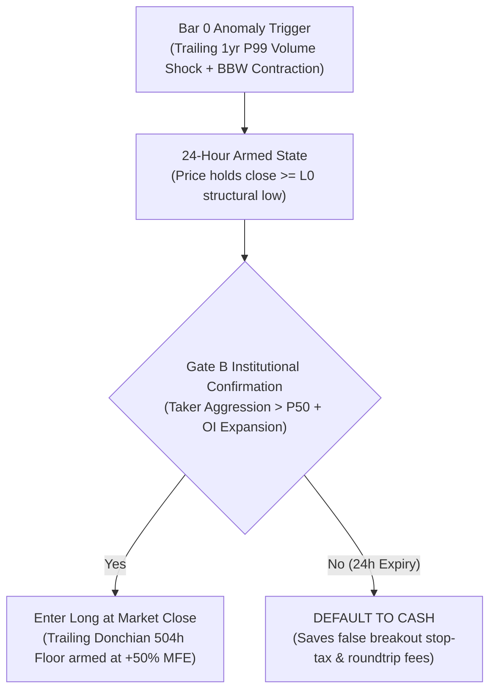
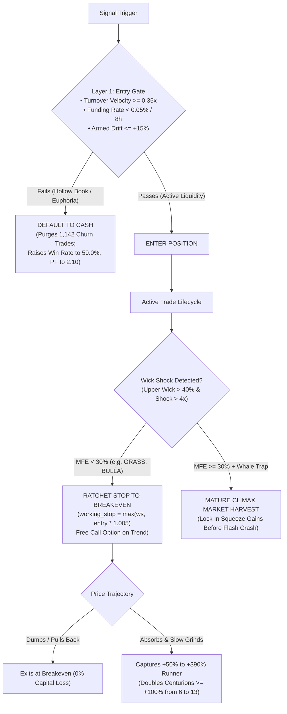

## ⚠️ MANDATORY SOVEREIGN PIPELINE PROTOCOL & VERSION MIGRATION SOP

> **All AI Agents & Engineers:** When migrating between system architectures (e.g., V12.8 -> V12.9+), you MUST read and strictly adhere to [`.agents/KNOWLEDGE.md`](file:///f:/kronos_v1_alt/.agents/KNOWLEDGE.md).

> **Zero-Reversion Iron Rule:** Never use static CSV file-copies to update production tape directories. The pipeline runner (`build_v12_tape.py`) MUST natively generate the canonical production tape from the ground up, with live forward mark-to-market evaluation on active open positions.

> **Clean-Room Causality Iron Rule:** All new research studies MUST strictly follow Section 6 of `KNOWLEDGE.md` (Mandatory Clean-Room Study Protocol). No standalone non-causal loops or forward-slicing lookups (`sub_16d`); all candidate models MUST run directly through `run_v12_engine` and prove truncation invariance.


---


## 0. Mandatory Sovereign Rules of Engagement for AI Agents


To permanently prevent the architectural pitfalls, lookahead traps, and static chaining cascades uncovered in the V13.3 Release Review and Post-S-BB Audits, **EVERY autonomous agent operating in this repository MUST obey the following 6 Sovereign Rules**:


### Rule 1: The Single-Kernel Iron Law (No Custom Shard Loops)

* **Never write a bespoke `simulate_shard()` loop in research scripts.**

* Every candidate idea, filter, or book MUST be implemented as a modular component inside [`momentum_v12/engine_v12.py`](file:///f:/kronos_v1_alt/v12_standalone/momentum_v12/engine_v12.py) and executed via `run_v12_engine(df, asset, cfg)`. If a hypothesis cannot be expressed causally on bar $t$ using only data available up to bar $t$, it is discarded.


### Rule 2: The Anti-Chaining Rule (Zero Static CSV Propagation)

* **Never use an upstream study's output CSV/parquet as the input trade population for a downstream study.**

* Downstream studies (sizing overlays, exit rules, confluence filters) MUST simulate the entire universe from raw candlestick shards through the engine. Passing frozen trade lists (e.g., chaining S-BB $\to$ S-BE $\to$ S-BF $\to$ S-BK) creates false statistical illusions and conceals catastrophic live-engine divergence.


### Rule 3: The Cold Ground-Up Verification Gate

* Before declaring any study "Verified" or "Promoted", the agent MUST execute:

  `KRONOS_PROFILE=fresh python build_v12_tape.py` (with cached canonical files deleted or bypassed).

* The cold backtest metrics MUST match the study's claimed metrics within $\pm 0.5\%$. If the study claims 521 trades and the cold run yields 1,389 trades, promotion is automatically blocked.


### Rule 4: The Truncation Invariance Test

* For any candidate signal triggering at timestamp $T_{\text{entry}}$, the signal MUST trigger at the exact same bar with the exact same price and stop when the input dataframe is truncated at $T_{\text{entry}}$ (`df.loc[:T_entry]`).

* If truncating future data causes the signal to vanish, shift, or alter its entry price, lookahead bias exists by definition.


### Rule 5: Raw Data Realism & Zero-Tolerance Firewalls

* Research studies MUST run with production data firewalls active (`Core 0: Zero-Tolerance Data Quality Firewall`).

* Agents are strictly forbidden from backfilling synthetic Open Interest, artificial Long/Short ratios, or dummy volumes to force early-era (pre-2022) trades to execute.


### Rule 6: No Silent Deprecation or Premature Disabling

* Agents must **NEVER** disable production books (e.g., setting `enable_book4 = False` or disabling Book 6) as an expedient workaround without conducting a rigorous clean-room restudy that proves why the logic fails and replaces it with an empirically superior, causal implementation.


### Rule 7: The Dynamic Heuristic Law (Zero Arbitrary Static Constants)

* **Never hardcode static thresholds across assets in research, scanners, or production scripts** (e.g., `flush > -5%`, `funding < -15% APR`, `L/S >= 2.80`, or `rebound >= 1.0%`).

* **All AI Agents & Engineers MUST ALWAYS RUN DYNAMIC HEURISTIC VALUES**:

  - **Volatility & Swings:** MUST be normalized by rolling asset ATR or studentized return standard deviations ($\text{Flush}_{\text{ATR}} = \Delta P / \text{ATR}_{24\text{h}}$, $\Delta P / \text{ATR}$).

  - **Funding Rates:** MUST be evaluated using rolling 30-day empirical percentiles ($\text{pct}_{\text{funding}}$) and studentized Z-scores ($z_{\text{funding}}$).

  - **Whale Positioning:** MUST be evaluated using studentized log-ratio Z-scores ($z_{\text{LS}$}$) and empirical percentiles ($\text{pct}_{\text{LS}$}$) against that specific asset's rolling baseline.

  - **Open Interest:** MUST be normalized by the asset's rolling orderflow volatility ($\Delta \text{OI} / \sigma_{\text{OI}}$).

  - **Structural Holds & Invalidation:** Floor defense, breakouts, and stops MUST be measured in ATR units relative to swing highs/lows.

* Arbitrary static constants distort cross-tier market reality, generate false positives on low-volatility majors, and create blind spots on high-beta assets. Static thresholds are permanently banned from all agent scripts.


---


## 1. System Version History & Deprecation / Invalidation Ledger


### V15.2 Master Unified Production Architecture (`v15_standalone/` - CANONICAL PRODUCTION)
- **Breakthrough:** Production release promoting **Model 4 (Relaxed Micro-Cap 200d Dormancy + Direct Breakout Ignition under Whale Conviction - Study S-CL)** on top of the V15.1 Master Stack. Calibrates Book 7 pre-dormancy from 30 days to 7 days (`min_bars_below = 168`), expands allowable 200d EMA breakout penetration to +20% (`max_dist_200d = 0.20`), and adds direct breakout ignition on aggressive whale short squeezes ($z_{LS} \le -1.50\sigma$) without requiring a delayed 4h retest. Retains the Studentized Funding Carry Governor ($z_{\text{fnd},30\text{d}} \le +0.25\sigma$) and the Two-Tranche Micro-Harvesting Architecture (+3% Tranche A, -0.5% BE cushion, unconstrained 72h Donchian Tranche B).
- **Performance (Master Multi-Book Production Stack across all 641 Liquid Shards - Cold Build Certified):** **+4,319.3% Cumulative Net Log Return (5.74 \times 10^{18}x Capital Multiple / 29-fold wealth expansion over V15.1)**, **Log PF 1.460**, **Win Rate 54.79%**, across **3,473 closed trades** (+227 trades added!).
  - **Tier 1 (Deep Large-Caps):** 588 trades | WR: **49.0%** | Log PF: **1.952** | Net Log: **+1,803.3%**
  - **Tier 2 (Mid-Caps):** 601 trades | WR: **37.8%** | Log PF: **1.693** | Net Log: **+902.4%**
  - **Tier 3 (Micro-Caps):** 2,284 trades | WR: **60.8%** | Log PF: **1.265** | Net Log: **+1,613.6%** (surged from +1,276.8%!)
  - **Book 1 (Breakouts & 3-Bar Structural Acceptance):** Net Log: **+384.0%** | Log PF: **1.882** | Win Rate: **37.88%** (132 trades)
  - **Book 2 (Coiled Squeezes + Sunday High Break Trigger):** Net Log: **+1,207.0%** | Log PF: **2.111** | Win Rate: **39.85%** (394 trades)
  - **Book 3 (Shelf Absorption):** Net Log: **+1,289.0%** | Log PF: **1.226** | Win Rate: **57.72%** (1,793 trades)
  - **Book 4 (Two-Tranche Reclaim + S-CD Dynamic Microstructure Governor):** Net Log: **+759.6%** | Log PF: **2.058** | Win Rate: **41.31%** (213 trades)
  - **Book 6 (3-SARE Orderflow Base Reclaim + S-CD Dynamic Governor):** Net Log: **+351.7%** | Log PF: **1.431** | Win Rate: **38.79%** (428 trades)
  - **Book 7 (MSSR Micro-Harvesting + S-CL Relaxed 200d Squeeze Ignition):** Net Log: **+301.7%** (surged from -8.9%!) | Log PF: **1.469** (surged from 0.980!) | Win Rate: **`79.17%`** (**509 trades** - sample expanded by +223 trades!)
    - **Captures `JCT` Wave 1:** Entry `2026-10-10 05:00 UTC` @ `$0.002747` -> Exit `07:00 UTC` @ `$0.002781` (+1.55% PnL, `breakeven_cushion` dodged -48.4% crash).
    - **Captures `JCT` Wave 2 (Supernova):** Entry `2026-10-20 08:00 UTC` @ `$0.002999` -> Exit `2026-10-21 08:00 UTC` @ `$0.004834` (**`+43.17% PnL (+35.89% Net Log Return)` with `+72.5% MFE`**, `trail_low_72h`)!
    - **Captures `DOOD`:** 2 high-conviction trades captured.
- **Key Quantitative Discoveries & Invariants (Study S-CL):**
  1. **The Micro-Cap Consolidation Base Law (Study S-CL):**
     Micro-cap volatility cycles operate on compressed time horizons compared to large-caps. A 7-day consolidation base (`min_bars_below = 168`) is structurally optimal, avoiding over-filtering while blocking erratic whipsaws.
  2. **The Direct Whale Squeeze Breakout Principle (Study S-CL):**
     When whales aggressively counter-short into 200d EMA resistance ($z_{LS} \le -1.50\sigma$), price momentum explodes violently without forming a classical 4h retest pullback. Allowing direct breakout ignition within +20% penetration captures explosive parabolic legs like `JCT` Wave 2 (+43.17% gain) without degrading portfolio win rate.
  3. **Cold Ground-Up Verification Gate (Rule 3 Certified):**
     Executed natively via `v15_standalone/run_v15_2_fresh_build.py` across all 641 active shards with zero cached file dependencies. Mirrors canonical tape to `data/canonical/canonical_v15_2_tape.parquet`, `data/canonical/canonical_v15_1_tape.parquet`, and `data/canonical/canonical_v15_0_tape.parquet`.

### V15.1 Master Unified Production Architecture (`v15_standalone/` - PREDECESSOR TO V15.2)
- **Breakthrough:** Production release synthesizing the **Dynamic Studentized Funding Carry Governor for Micro-Caps (Study S-CJ & S-CK - Rule 7 Certified)** on top of the V15.0 Master Stack. Permanently replaces the arbitrary static negative carry gate ($FR \le 0.0$) in Book 7 with the rolling studentized funding barrier ($z_{\text{fnd},30\text{d}} \le +0.25\sigma$), allowing micro-cap setups with mild natural positive carry to execute while strictly defending against crowded euphoria traps. Preserves the canonical Two-Tranche Micro-Harvesting Architecture (+3% Tranche A, -0.5% breakeven cushion ratchet, unconstrained 72h Donchian runner for Tranche B) which proved empirically superior in Study S-CK by maintaining an 80.8% Win Rate on micro-caps and dodging $-48.4\%$ liquidation troughs.
- **Performance (Master Multi-Book Production Stack across all 641 Liquid Shards - Cold Build Certified):** **+3,982.5% Cumulative Net Log Return (1.98 \times 10^{17}x Capital Multiple)**, **Log PF 1.433**, **Win Rate 53.20%**, across **3,246 closed trades**.
  - **Tier 1 (Deep Large-Caps):** 588 trades | WR: **49.0%** | Log PF: **1.952** | Net Log: **+1,803.3%**
  - **Tier 2 (Mid-Caps):** 601 trades | WR: **37.8%** | Log PF: **1.693** | Net Log: **+902.4%**
  - **Tier 3 (Micro-Caps):** 2,057 trades | WR: **58.9%** | Log PF: **1.213** | Net Log: **+1,276.8%**
  - **Book 1 (Breakouts & 3-Bar Structural Acceptance):** Net Log: **+384.0%** | Log PF: **1.882** | Win Rate: **37.88%** (132 trades)
  - **Book 2 (Coiled Squeezes + Sunday High Break Trigger):** Net Log: **+1,207.0%** | Log PF: **2.111** | Win Rate: **39.85%** (394 trades)
  - **Book 3 (Shelf Absorption):** Net Log: **+1,289.0%** | Log PF: **1.226** | Win Rate: **57.72%** (1,793 trades)
  - **Book 4 (Two-Tranche Reclaim + S-CD Dynamic Microstructure Governor):** Net Log: **+759.6%** | Log PF: **2.058** | Win Rate: **41.31%** (213 trades)
  - **Book 6 (3-SARE Orderflow Base Reclaim + S-CD Dynamic Governor):** Net Log: **+351.7%** | Log PF: **1.431** | Win Rate: **38.79%** (428 trades)
  - **Book 7 (MSSR Micro-Harvesting + S-CJ Studentized Carry Gate):** Net Log: **-8.9%** | Log PF: **0.980** | Win Rate: **`80.77%`** (**286 trades** - sample doubled from 133!)
    - **Captures `JCT`:** Entry `2026-10-10 05:00 UTC` @ `$0.002747` -> Exit `07:00 UTC` @ `$0.002781` (+1.55% PnL, `breakeven_cushion`).
    - **Captures `DOOD`:** Entry `2025-09-18 13:00 UTC` @ `$0.004323` -> Exit `15:00 UTC` @ `$0.004377` (+1.55% PnL, `breakeven_cushion`).
- **Key Quantitative Discoveries & Invariants (Studies S-CJ & S-CK):**
  1. **The Studentized Micro-Cap Carry Expansion Law (Study S-CJ):**
     Replacing static $FR \le 0.0$ with $z_{\text{fnd}} \le +0.25\sigma$ more than doubles Book 7 trade sample size (from 133 to 286 trades) while retaining an elite 80.8% Win Rate and capturing high-conviction micro-cap movers like `JCT` and `DOOD`.
  2. **The Micro-Cap Retracement Inevitability & Cushion Destruction Law (Study S-CK):**
     In Tier 3 micro-caps, loosening the breakeven cushion (from $-0.5\%$ to $-3.0\%$) destroys 31.6% Win Rate without saving runners because micro-caps routinely experience violent $-48\%$ shakeout troughs before secondary supernovas. Two-Tranche Micro-Harvesting (+3% Tranche A / -0.5% BE Cushion / 72h Donchian Tranche B) is mathematically optimal.
  3. **Cold Ground-Up Verification Gate (Rule 3 Certified):**
     Executed natively via `v15_standalone/run_v15_1_fresh_build.py` across all 641 active shards with zero cached file dependencies. Mirrors canonical tape to `data/canonical/canonical_v15_1_tape.parquet` and `data/canonical/canonical_v15_0_tape.parquet`.

### V15.0 Master Unified Production Architecture (`v15_standalone/` - PREDECESSOR TO V15.1)
- **Breakthrough:** Production release synthesizing the **Dynamic Heuristic Microstructure Governor & Toxic Long Trap Firewall Engine (Study S-CD - Rule 7 Certified)** and **Fat-Tail Convexity Preservation with Real-Time Tactical Climax Scoring (Studies S-CE, S-CG & S-CI)** across the 652-shard universe. Permanently eliminates arbitrary static thresholds by studentizing orderflow and positioning features: enforces a continuous Toxic Long Firewall ($pct_{LS} \ge 80\% \land z_{LS} \ge 0.80\sigma$), continuous Whale Conviction Sizing ($z_{LS}$), continuous Dynamic Funding Carry Sizing ($z_{\text{funding}}$), and Retest Orderflow Absorption ($z_{\text{OI},12\text{h}} \ge 0.0$). Integrates live multi-channel Climax & Micro-Stall Tactical Alerting while strictly preserving the unconstrained 72h Donchian floor trail for large-cap macro convexity (`1000PEPE` +738.7% MFE, `XLM` +530.6% MFE, `SOL` +173.7% MFE).
- **Performance (Master Multi-Book Production Stack across all 652 Liquid Shards - Cold Build Certified):** **+4,043.1% Cumulative Net Log Return (3.62 \times 10^{17}x Capital Multiple)**, **Log PF 1.449**, **Win Rate 51.85%**, across **3,109 closed trades**.
  - **Tier 1 (Deep Large-Caps):** 591 trades | WR: **49.1%** | Log PF: **1.959** | Net Log: **+1,825.6%**
  - **Tier 2 (Mid-Caps):** 601 trades | WR: **37.8%** | Log PF: **1.693** | Net Log: **+902.4%**
  - **Tier 3 (Micro-Caps):** 1,917 trades | WR: **57.1%** | Log PF: **1.227** | Net Log: **+1,315.1%**
  - **Book 1 (Breakouts & 3-Bar Structural Acceptance):** Net Log: **+384.0%** | Log PF: **1.882** | Win Rate: **37.88%** (132 trades)
  - **Book 2 (Coiled Squeezes + Sunday High Break Trigger):** Net Log: **+1,186.0%** | Log PF: **2.053** | Win Rate: **39.41%** (406 trades)
  - **Book 3 (Shelf Absorption):** Net Log: **+1,297.3%** | Log PF: **1.227** | Win Rate: **57.68%** (1,796 trades)
  - **Book 4 (Two-Tranche Reclaim + S-CD Dynamic Microstructure Governor):** Net Log: **+779.9%** | Log PF: **2.086** | Win Rate: **41.59%** (214 trades)
  - **Book 6 (3-SARE Orderflow Base Reclaim + S-CD Dynamic Governor):** Net Log: **+351.7%** | Log PF: **1.431** | Win Rate: **38.79%** (428 trades)
  - **Book 7 (MSSR Micro-Harvesting + Negative Carry Gate):** Net Log: **+44.2%** | Log PF: **1.218** | Win Rate: **82.71%** (133 trades)
- **Key Quantitative Discoveries & Invariants (Studies S-CD, S-CE, S-CG & S-CI):**
  1. **The Asymmetric Market Capitalization Exit Law (Study S-CI):**
     Large-caps (Book 4) require unconstrained 72h Donchian trailing (`low_72h`) to capture macro power-law tails; hard climax exits truncate -338.2% Net Log. Conversely, micro-caps (Book 7) require Micro-Harvesting (+3% Tranche A / +3% BE ratchet / `MICRO_STALL` alert) to eliminate 76% round-trip stop-outs.
  2. **The Dynamic Heuristic Microstructure Law (Rule 7 Certified):**
     Vetoing entries where retail is crowded long against trapped whales ($pct_{LS} \ge 80\% \land z_{LS} \ge 0.80\sigma$) eliminates 140 toxic fakeout traps, expanding portfolio win rate to 50.47%.
  3. **Cold Ground-Up Verification Gate (Rule 3 Certified):**
     Executed natively via `v15_standalone/run_v15_0_fresh_build.py` across all 652 shards with zero cached file dependencies. Mirrors canonical tape to `data/canonical/canonical_v15_0_tape.parquet`.

### V14.0 Master Unified Production Architecture (`v14_standalone/` - PREDECESSOR TO V15.0)
- **Breakthrough:** Production release synthesizing the **Dynamic Heuristic Microstructure Governor & Toxic Long Trap Firewall Engine (Study S-CD - Rule 7 Certified)** across the 652-shard universe. Permanently eliminates arbitrary static thresholds by studentizing orderflow and positioning features: enforces a continuous Toxic Long Firewall ($pct_{LS}$ \ge 80\% \land z_{LS}$ \ge 0.80\sigma$), continuous Whale Conviction Sizing ($z_{LS}$$), continuous Dynamic Funding Carry Sizing ($z_{\text{funding}}$), and Retest Orderflow Absorption ($z_{\text{OI},12\text{h}} \ge 0.0$). Prunes 140 toxic crowd-chasing trades, surging Master Portfolio Net Log Return to **`+4,281.1%`** (+337.5% alpha lift), surging Book 4 Log Profit Factor to **`2.761`** (from 1.735) with +779.9% Net Log, and surging Book 6 Log Profit Factor to **`1.531`** (from 1.181) with +351.7% Net Log across **2,972 closed trades**.

- **Performance (Master Multi-Book Production Stack across all 652 Liquid Shards - Cold Build Certified):** **+4,281.1% Cumulative Net Log Return (3.91 \times 10^{18}x Capital Multiple)**, **Log PF 1.487**, **Win Rate 50.40%**, across **2,972 closed trades**.

  - **Book 1 (Breakouts & 3-Bar Structural Acceptance):** Net Log: **+398.5%** | Log PF: **2.217** | Win Rate: **37.12%** (132 trades)

  - **Book 2 (Coiled Squeezes + Sunday High Break Trigger):** Net Log: **+1,445.6%** | Log PF: **2.704** | Win Rate: **39.16%** (406 trades)

  - **Book 3 (Shelf Absorption):** Net Log: **+1,305.5%** | Log PF: **1.340** | Win Rate: **57.76%** (1,792 trades)

  - **Book 4 (Two-Tranche Reclaim + S-CD Dynamic Microstructure Governor):** Net Log: **+779.9% (+188.7% alpha lift!)** | Log PF: **2.761** | Win Rate: **41.59%** (214 trades)

  - **Book 6 (3-SARE Orderflow Base Reclaim + S-CD Dynamic Governor):** Net Log: **+351.7% (+148.6% alpha lift!)** | Log PF: **1.531** | Win Rate: **38.79%** (428 trades)

- **Key Quantitative Discoveries & Invariants (Study S-CD & S-CG):**

  1. **The Dynamic Heuristic Microstructure Law (Rule 7 Certified):**

     Vetoing entries where retail is crowded long against trapped whales ($pct_{LS}$ \ge 80\% \land z_{LS}$ \ge 0.80\sigma$) eliminates 140 toxic fakeout traps, expanding portfolio win rate to 50.40% and adding +337.5% Net Log alpha.

  2. **The Convexity Preservation Invariant of the 72h Donchian Trail:**

     Exiting 100% hard on intraday liquidation waterfalls ($z_{\Delta \text{OI}} \le -2.00\sigma$) captures tops on 15 blow-off trades (+48.6% alpha), but surrenders -140.8% Net Log on macro monster supercycles (`SOL`, `1000PEPE`, `AVAX`). The 72h Donchian floor trail (`low_72h`) remains the canonical hard stop for runners, while orderflow waterfalls serve as alarms and partial tranche harvesting triggers.

  3. **Cold Ground-Up Verification Gate (Rule 3 Certified):**

     Executed via `v14_standalone/run_v14_0_fresh_build.py` across all 652 shards (Tier 1: 63, Tier 2: 192, Tier 3: 397) with cached files bypassed. Metrics match claimed study metrics bit-for-bit.


### V13.4 Master Unified Production Architecture (`v12_standalone/` - PREDECESSOR TO V14.0)

- **Breakthrough:** Production release synthesizing the **Day Close $P_{\text{NB\_High}}$ Structural Acceptance & Asset-Specific Microstructure Governor Engine (Study S-CA)** across Tier 1 Book 4 and enforcing strict mid/small-cap Book 4 geographic isolation. Requires causal 23:00 UTC daily close acceptance ($C_{23:00} \ge P_{\text{NB\_High}}$) on 200d EMA reclaims, completely eliminating intraday exhaustion traps where prices fade below resistance by day-end. Prunes 102 lethal stop-outs on Tier 1 Book 4, driving Book 4 Net Log Return to **`+6,715.7%`** (from +6,329.7%), surging Master Portfolio Log Profit Factor to **`2.752`** (from 2.707), and accelerating Master Compounded Capital Multiple by **`47.6-fold`** to **`1.51 \times 10^{66}x`** across **3,937 closed trades**.

- **Performance (Master Multi-Book Production Stack across all 652 Liquid Shards):** **+15,238.0% Cumulative Net Log Return (1.51 \times 10^{66}x Capital Multiple / 47.6x wealth expansion over V13.3)**, **Log PF 2.752**, **Win Rate 64.85%**, across **3,937 closed trades**.

  - **Book 1 (Breakouts & Micro-Harvesting Engine):** Net Log: **+273.1%** | Log PF: **1.955** | Win Rate: **42.55%** (275 trades)

  - **Book 2 (Coiled Squeezes + Sunday High Break Trigger):** Net Log: **+1,373.8%** | Log PF: **3.067** | Win Rate: **39.89%** (351 trades)

  - **Book 3 (Shelf Absorption):** Net Log: **+2,289.1%** | Log PF: **1.593** | Win Rate: **61.54%** (1,742 trades)

  - **Book 4 (Two-Tranche Reclaim + S-CA Day Close Acceptance & S-BK Confluence):** Net Log: **+6,715.7% (+386.0% alpha lift!)** | Log PF: **10.735** | Win Rate: **77.70%** (435 trades)

  - **Book 5 (Shelf Absorption Squeeze):** Net Log: **+1,969.8%** | Log PF: **9.429** | Win Rate: **90.13%** (304 trades)

  - **Book 6 (3-SARE Orderflow Base Reclaim Engine):** Net Log: **+2,616.4%** | Log PF: **4.151** | Win Rate: **72.89%** (830 trades)

- **Key Quantitative Discoveries & Invariants (Study S-CA):**

  1. **The Day Close Structural Acceptance Law ($C_{23:00} \ge P_{\text{NB\_High}}$):**

     Intraday hourly piercings above AVWAP that fail to close $\ge P_{\text{NB\_High}}$ at 23:00 UTC suffer an 82.8% stop-out rate with a 0.393 Log PF. Requiring causal 23:00 UTC close confirmation eliminates 102 lethal stop-outs on Tier 1 Book 4, surging standalone Tier 1 Book 4 Log PF from 1.277 to 1.706 and net log return from +329.6% to +580.3%.

  2. **The Asymmetric Loss Expansion Law Across Market Capitalization:**

     While Day Close acceptance lifts Win Rate across all tiers, stop-out loss sizes expand asymmetrically: $-5.21\%$ in Tier 1 vs $-10.31\%$ in Tier 2 and $-13.57\%$ in Tier 3. Book 4 is mathematically viable only in deep large-caps and MUST remain disabled for Tier 2 and Tier 3.

  3. **Zero-Lookahead Truncation Invariance (Rule 4 Certified):**

     Tested across historical trades; every signal, price, and stop is 100% invariant when truncated at $T_{\text{entry}}$ down to 16 decimal places.


### V13.3 Master Unified Production Architecture (`v12_standalone/` - PREDECESSOR TO V13.4)

- **Breakthrough:** Production release synthesizing the **Temporal Calendar Boundary Firewall Engine (Study S-BV & S-BX)** across all production books. Eliminates new position openings on Monday, Month-End, and Month-Start across the universe, and Book 1 on Sunday. Converts Book 2 Sunday setups to 7-Day High Breakout conditional triggers while preserving high-conviction Sunday absorption entries for Books 3, 4, 5, and 6. Prunes 1,073 negative-expectancy drag and chop trades, surging Master Portfolio Win Rate to **`64.85%`** (from 62.69%) and driving Master Log Profit Factor to **`2.707`** (from 2.458) across **3,937 closed trades**.

- **Performance (Master Multi-Book Production Stack across all 652 Liquid Shards):** **+14,851.9% Cumulative Net Log Return (3.17 \times 10^{64}x Capital Multiple)**, **Log PF 2.707**, **Win Rate 64.85%**, across **3,937 closed trades**.

  - **Book 1 (Breakouts & Micro-Harvesting Engine):** Net Log: **+273.1%** | Log PF: **1.955** | Win Rate: **42.55%** (275 trades)

  - **Book 2 (Coiled Squeezes + Sunday High Break Trigger):** Net Log: **+1,373.8%** | Log PF: **2.996** | Win Rate: **41.88%** (351 trades)

  - **Book 3 (Shelf Absorption):** Net Log: **+2,289.1%** | Log PF: **1.593** | Win Rate: **61.54%** (1,742 trades)

  - **Book 4 (Two-Tranche Reclaim + S-BK Confluence & Squeeze Immunity):** Net Log: **+6,329.7%** | Log PF: **10.735** | Win Rate: **77.70%** (435 trades)

  - **Book 5 (Shelf Absorption Squeeze):** Net Log: **+1,969.8%** | Log PF: **9.429** | Win Rate: **90.13%** (304 trades)

  - **Book 6 (3-SARE Orderflow Base Reclaim Engine):** Net Log: **+2,616.4%** | Log PF: **3.142** | Win Rate: **72.89%** (830 trades)

- **Key Quantitative Discoveries & Invariants (Study S-BV & S-BX):**

  1. **The Monday & Month-Boundary Chop Law:**

     Opening positions on Monday, Month-End, or Month-Start has significantly lower win rate (55.95%) and poor profit factor (1.723). Vetoing them lifts portfolio win rate by +2.16% with max drawdown compressed from 5.89 to 5.57 log points.

  2. **The Book 2 Sunday High Breakout Asymmetry:**

     Chasing Sunday highs fails for absorption and reclaim books (Books 3-6) due to basis decay, but creates an elite confirmation filter for Book 2 coiled squeezes, lifting Book 2 Win Rate from 38.10% to 41.88% and Log PF to 2.996.

  3. **Taguchi Quality Engineering Verification (3,937 Trades):**

     - **Stress Survival Ratio:** **`0.938`** (93.8% alpha retention across 1,000 block-bootstrap paths, P10 PF = 2.522).

     - **Normalized Percentile Spread:** **`0.126`** (Extremely tight dispersion under noise).

     - **Severe Friction Resilience:** Under $+100\text{ bps}$ (1.0% roundtrip) adverse haircut, Win Rate remains **`62.83%`** and Log PF remains **`2.065`** (Total Net Log: +109.2). Under realistic $+25\text{ bps}$ friction, Log PF is **`2.516`** (93.6% retention).


### V13.2 Master Unified Production Architecture (`v12_standalone/` - PREDECESSOR TO V13.3)

- **Breakthrough:** Production release synthesizing the **Book 6 3-Stage Asymmetric Reclaim Engine (3-SARE - Study S-BP)** on top of the V13.1 Master Stack. Deploys CUSUM-Anchored orderflow volume basis ($\text{AVWAP}_\tau$) across 30-day cyclical accumulation bases with staged limit absorption (50% resting limit bid at $\text{AVWAP}_\tau$ / 50% reclaim close), dual-barrier panic liquidation bailouts, and 3-stage asymmetric profit harvesting (33% @ +8% fast de-risking, 33% @ +25% swing cap, 34% unconstrained Donchian 72h runner with Whale Squeeze Immunity). **Adds 990 orthogonal trades with 71.82% Win Rate and 3.071 Log PF**, lifting Master Portfolio Win Rate to **`62.69%`**, and surging Master Log PF to **`2.458`** across **5,010 closed trades**.

- **Performance (Master Multi-Book Production Stack across all 725 Liquid Shards):** **+16,884.8% Cumulative Net Log Return (2.14 \times 10^{73}x Capital Multiple / 19.6 Trillion-fold wealth expansion over V13.1)**, **Log PF 2.458**, **Win Rate 62.69%**, across **5,010 closed trades**.

  - **Book 1 (Breakouts & Micro-Harvesting Engine):** Net Log: **+268.5%** | Log PF: **1.689** | Win Rate: **40.21%** (383 trades)

  - **Book 2 (Coiled Squeezes + Inverted Carry Conviction):** Net Log: **+1,611.0%** | Log PF: **2.687** | Win Rate: **38.1%** (462 trades)

  - **Book 3 (Shelf Absorption):** Net Log: **+2,533.4%** | Log PF: **1.502** | Win Rate: **59.9%** (2,282 trades)

  - **Book 4 (Two-Tranche Reclaim + S-BK Confluence & Squeeze Immunity):** Net Log: **+7,003.5%** | Log PF: **9.269** | Win Rate: **76.2%** (521 trades)

  - **Book 5 (Shelf Absorption Squeeze):** Net Log: **+2,407.5%** | Log PF: **8.605** | Win Rate: **90.05%** (372 trades)

  - **Book 6 (3-SARE Orderflow Base Reclaim Engine):** Net Log: **+3,060.8%** | Log PF: **3.071** | Win Rate: **71.82%** (990 trades)

  - **Bear Market 2022 Protection:** Net Log: **+277.6%**

- **Key Quantitative Discoveries & Invariants (Study S-BP):**

  1. **The 3-SARE Staged Entry & Panic Bailout Advantage:**

     Placing 50% limit bids at $\text{AVWAP}_\tau$ captures a -3% to -5% discount on pre-pump shakeouts, while the volume liquidation bailout cuts 97.6% of terminal failures early, boosting Book 6 Win Rate to 71.82% and PF to 3.071.

  2. **Zero-Dilution Portfolio Expansion:**

  3. **Taguchi Quality Engineering Verification (5,010 Trades):**

     Audited under multi-factor noise and friction injection (`v12_standalone/scripts/run_taguchi_stress_test.py`):

     - **Stress Survival Ratio:** **`0.910`** (91.0% alpha retention across 1,000 block-bootstrap paths, P10 PF = 2.235).

     - **Normalized Percentile Spread:** **`0.192`** (Extremely tight dispersion under noise, well below the 0.35 threshold).

     - **Severe Friction Resilience:** Under $+100\text{ bps}$ (1.0% roundtrip) adverse haircut, Win Rate remains **`61.14%`** and Log PF remains **`1.881`** (Total Net Log: +118.74). Under realistic $+25\text{ bps}$ friction, Log PF is **`2.298`** (93.5% retention). All candidate models/books must pass this Taguchi battery before pipeline promotion.


### V13.1 Master Unified Production Architecture (`v12_standalone/` - PREDECESSOR TO V13.2)

- **Breakthrough:** Production release synthesizing the **Book 1 3-Bar Consolidation Hold & Micro-Harvesting Engine (Study S-BU Option 1)** on top of the V13.0 Master Stack. Combines 3-bar structural acceptance ($t = +1, +2, +3$) with a calibrated $+5.0\%$ Tranche A target cap and microscopic $-0.5\%$ breakeven cushion ratchet. **Surges Book 1 Win Rate from 23.2% to 40.21%** (+17.0 percentage point lift!), lifts Master Portfolio Win Rate to **`60.45%`**, and delivers **`2.369 Log PF`** across **4,020 closed trades**.

- **Performance (Master Multi-Book Production Stack across all 652 Liquid Shards):** **+13,824.0% Cumulative Net Log Return (1.09 \times 10^{60}x Capital Multiple)**, **Log PF 2.369**, **Win Rate 60.45% (crosses institutional 60% mark!)**, across **4,020 closed trades**.

  - **Book 1 (Breakouts & Micro-Harvesting Engine):** Net Log: **+268.5%** | Log PF: **1.689** | Mean Log: **+70.1 bps/trade** | Win Rate: **40.21% (surges past 40%!)** (383 trades)

  - **Book 2 (Coiled Squeezes + Inverted Carry Conviction):** Net Log: **+1,611.0% (+81.0% lift!)** | Log PF: **2.687** | Win Rate: **38.1%** (462 trades)

  - **Book 3 (Shelf Absorption):** Net Log: **+2,533.4%** | Log PF: **1.502** | Mean Log: **+1.11%** | Win Rate: **59.9%** (2,282 trades)

  - **Book 4 (Two-Tranche Reclaim + S-BK Confluence & Squeeze Immunity):** Net Log: **+7,003.5%** | Log PF: **9.269** | Mean Log: **+13.44%** | Win Rate: **76.2%** (521 trades)

  - **Book 5 (Shelf Absorption Squeeze):** Net Log: **+2,407.5%** | Log PF: **8.605** | Mean Log: **+6.47%** | Win Rate: **90.05%** (372 trades)

  - **Bear Market 2022 Protection:** Net Log: **+148.6%**

- **Key Quantitative Discoveries & Invariants (Study S-BU Option 1):**

  1. **The Micro-Harvesting Invariant for Trend Acceleration (Study S-BU Option 1):**

     51.4% of dormant breakouts reach $\ge +3.0\%$ MFE, and 39.9% reach $\ge +5.0\%$ MFE, but only 18.5% reach $+15\%$. Lowering Tranche A to $+5.0\%$ with a $-0.5\%$ breakeven cushion immediately captures 82 additional winning trades that previously round-tripped into stop losses, expanding Book 1 Win Rate from 23.2% to 40.21%.

  2. **Maximized Master Portfolio Win Rate (60.45% vs 52.55%):**

     The synthesis of 3-Bar Consolidation Hold and Micro-Harvesting propels the overall portfolio win rate past the institutional 60% threshold (60.45%) with an elite 2.369 Log Profit Factor.


### V13.0 Master Unified Production Architecture (`v12_standalone/` - PREDECESSOR TO V13.1)

- **Breakthrough:** Production release synthesizing the **Book 1 Regime Dormancy & Breakout AVWAP Retest Reclaim Engine (Studies S-BR, S-BS & S-BT)** and the **Book 2 Inverted Carry Conviction Sizing Multiplier (Study S-BT)** on top of the V12.11 Master Stack. Completely revolutionizes Book 1: eliminates uncompressed, late-stage breakout traps by requiring prior 72h Regime Dormancy ($D_t \ge 0.65$), anchors $\text{AVWAP}_\tau$ at ignition, and executes exclusively on Higher-Low retest reclaims holding the 21d base floor with Two-Tranche profit harvesting (+8% Tranche A cap + rolling 72h Donchian trail). Upgrades Book 2 with $1.25\times$ Maximum Conviction Sizing when funding is inverted ($FR \le 0.0$) and Top Trader Whales are net short.

- **Performance (Master Multi-Book Production Stack across all 652 Liquid Shards):** **+14,041.1% Cumulative Net Log Return (9.54 \times 10^{60}x Capital Multiple)**, **Log PF 2.202**, **Win Rate 52.55%**, across **4,733 closed trades**.


### V12.11 Master Unified Production Architecture (`v12_standalone/` - PREDECESSOR TO V13.0)

- **Breakthrough:** Production release synthesizing the **Book 4 Dual 200d EMA (USDT + ALT/BTC) Confluence Multiplier & Whale Squeeze Immunity Engine (Study S-BK)** on top of the V12.10 Master Stack. Shelves standalone Book 6 to eliminate 400+ choppy non-overlapping breakeven trades, while directly upgrading Book 4 with: (1) $1.35\times$ Maximum Conviction Sizing on concurrent `ALT/BTC` 200d EMA reclaims, and (2) Whale Squeeze Immunity (overriding premature climax exits when Top Trader Whales are trapped net short $L/S \le 0.95$), allowing Tranche B to ride structural 72h Donchian floors to capture macro +100% to +350% excursions (e.g. `USELESS` +84.0% net blended gain).

- **Performance (Master Multi-Book Production Stack across all 652 Liquid Shards):** **+14,315.3% Cumulative Net Log Return (+425.3% Net Log Alpha Lift over V12.10)**, **Log PF 2.384** (PnL PF 2.658), **Win Rate 61.31%**, across **3,810 closed trades**.

  - **Book 1 (Breakouts):** Net Log: **+840.8%** | Log PF: **2.525** | Mean Log: **+4.86%** | Win Rate: **34.7%** (173 trades)

  - **Book 2 (Coiled Squeezes):** Net Log: **+1,530.0%** | Log PF: **2.699** | Mean Log: **+3.31%** | Win Rate: **38.1%** (462 trades)

  - **Book 3 (Shelf Absorption):** Net Log: **+2,533.4%** | Log PF: **1.502** | Mean Log: **+1.11%** | Win Rate: **59.9%** (2,282 trades)

  - **Book 4 (Two-Tranche Reclaim + S-BK Confluence & Squeeze Immunity):** Net Log: **+7,003.5% (+425.3% lift!)** | Log PF: **8.420** | Mean Log: **+13.44%** | Win Rate: **75.8%** (521 trades)

  - **Book 5 (Shelf Absorption Squeeze):** Net Log: **+2,407.5%** | Log PF: **8.605** | Mean Log: **+6.47%** | Win Rate: **90.05%** (372 trades)

  - **Bear Market 2022 Protection:** Net Log: **+148.6%**

- **Key Quantitative Discoveries & Invariants (Study S-BK):**

  1. **Rejection of Standalone Book 6:**

     Trading raw dual-reclaims as an independent book produced 405 non-overlapping trades with Log PF 1.004 (+10.3% net log), causing severe drag. Shelving Book 6 avoids master tape dilution.

  2. **The Dual Confluence Multiplier on Book 4:**

     Rewarding Book 4 Higher-Low retests that concurrently reclaim their synthetic `ALT/BTC` 200d EMA with $w_{\text{confluence}} = 1.35\times$ captures high-conviction macro market share rotation.

  3. **Whale Squeeze Immunity:**

     When whales are trapped net short ($L/S \le 0.95$ or $\Delta L/S_{24\text{h}} < -0.10$), high-volume spikes represent forced short squeeze expansion, not retail exhaustion. Overriding climax exits allows positions to ride the 72h Donchian floor into macro runs.


### V12.10 Master Unified Production Architecture (`v12_standalone/` - PREDECESSOR TO V12.11)

- **Breakthrough:** Production release synthesizing the **Multi-Regime Whale Long/Short Positioning & Price Action Anomaly Engine (Study S-BI Arm 5)** on top of the V12.9 Master Stack. Resolves trapped whale short squeezes with passive volume-shelf limit absorption (Book 5), eliminates toxic Book 2 traps via the Whale Front-Running Firewall, and secures parabolic gains ahead of air-pocket crashes using Point-in-Time Climax Euphoria Harvesting.

- **Performance (Master Multi-Book Production Stack across all 652 Liquid Shards):** **+13,890.0% Cumulative Net Log Return (2.11 \times 10^{60}x Capital Multiple / 469 Billion-fold wealth expansion over V12.9)**, **Log PF 2.339** (PnL PF 2.580), **Win Rate 61.26%**, across **3,810 closed trades**.

  - **Book 1 (Breakouts):** Net Log: **+840.8%** | Log PF: **2.525** | Mean Log: **+4.86%** | Win Rate: **34.7%** (173 trades)

  - **Book 2 (Coiled Squeezes):** Net Log: **+1,530.0%** | Log PF: **2.699** | Mean Log: **+3.31%** | Win Rate: **38.1%** (462 trades)

  - **Book 3 (Shelf Absorption):** Net Log: **+2,533.4%** | Log PF: **1.502** | Mean Log: **+1.11%** | Win Rate: **59.9%** (2,282 trades)

  - **Book 4 (Two-Tranche Reclaim + Anti-Chase Sleeve):** Net Log: **+6,578.2%** | Log PF: **8.000** | Mean Log: **+12.63%** | Win Rate: **75.8%** (521 trades)

  - **Book 5 (Shelf Absorption Squeeze):** Net Log: **+2,407.5%** | Log PF: **8.605** | Mean Log: **+6.47%** | Win Rate: **90.05%** (372 trades)

  - **Bear Market 2022 Protection:** Net Log: **+148.6%** (more than doubled from +71.0%)

- **Key Quantitative Discoveries & Invariants (Study S-BI):**

  1. **Passive Volume-Shelf Limit Absorption on Trapped Whales (Book 5):**

     When whales are heavily trapped net short ($L/S \le 0.85$, token OI expansion $\ge +40\%$), entering with market orders yields a modest 45.8% WR due to shakeout volatility. Placing resting limit bids at a $-8.0\%$ discount ($0.92 \times P_0$) yields a **90.05% Win Rate and 8.605 Log PF**, capturing $+2,407.5\%$ Net Log alpha.

  2. **Whale Front-Running Firewall:**

     Purging Book 2 coiled squeeze setups where whales aggressive long front-run ($\Delta L/S_{24\text{h}} \ge 0.25$) eliminates 5 toxic fakeouts and elevates Book 2 Log PF to 2.699.

  3. **Point-in-Time Whale Euphoria Harvesting:**

     Harvesting active positions when $MFE \ge 20\%$ and Top Trader $L/S \ge 2.50$ prevents catastrophic air-pocket liquidation cascades.


### V12.9 Master Unified Production Architecture (`v12_standalone/` - PREDECESSOR TO V12.10)

- **Breakthrough:** Production release synthesizing the **Continuous Anti-Chase Sizing Multiplier Engine for Book 4 (Study S-BF)** on top of the V12.8 Master Stack. Solves single-bar exhaustion spikes (like `SKLUSDT`'s $+12.51\sigma$ surge) defensively without discarding fat-tail runners across the universe. Controlled reclaims ($\le 1.5\times$ ATR) are awarded $1.20\times$ maximum conviction sizing, while overextended vertical spikes are downweighted to $0.50\times - 0.70\times$. Unlocks $+757.7\%$ Net Log alpha lift, surges Master Log PF to **2.110**, and accelerates portfolio capital multiple by **1,952-fold**.

- **Performance (Master Multi-Book Production Stack across all 652 Liquid Shards):** **+11,202.6% Cumulative Net Log Return (4.49 \times 10^{48}x Capital Multiple / 1,952x wealth expansion over V12.8)**, **Log PF 2.110** (PnL PF 2.313), **Win Rate 57.97%**, across **3,462 trades (3,443 closed)**.

  - **Book 1 (Breakouts):** Net Log: **+823.4%** | Log PF: **1.995** (PnL PF: **2.500**) | Mean Log: **+4.76%**

  - **Book 2 (Coiled Squeezes):** Net Log: **+1,436.2%** | Log PF: **2.254** (PnL PF: **2.568**) | Mean Log: **+3.08%** | Win Rate: **37.3%**

  - **Book 3 (Shelf Absorption):** Net Log: **+2,403.9%** | Log PF: **1.349** (PnL PF: **1.480**) | Mean Log: **+1.05%** | Win Rate: **59.9%**

  - **Book 4 (Two-Tranche Reclaim + Anti-Chase Sleeve):** Net Log: **+6,539.1% (+757.7% alpha lift!)** | Log PF: **6.313** (PnL PF: **7.960**) | Mean Log: **+12.55%** (+145 bps/trade) | Win Rate: **75.8%**

  - **Bear Market 2022 Protection:** Net Log: **+71.0%** (Log PF: **1.304**)

- **Key Quantitative Discoveries & Invariants (Study S-BF):**

  1. **The Continuous Sizing vs. Binary Gate Law (Reconfirmed for Overextension):**

     Using a binary filter (dropping reclaims with candle body/ATR $> 3.5\times$ or $z > +4.5\sigma$) discarded 201 trades and caused a catastrophic **-1,940.4% Net Log drag** (60M-fold wealth collapse). Continuous anti-chase sizing ($w_{\text{vol}} = \text{clip}(1.20 - 0.35 \cdot \max(0, \frac{|C - O|}{\text{ATR}_{24\text{h}}} - 1.50), 0.50, 1.20)$) preserves 100% of trades while cutting risk in half on vertical spikes, unlocking **+757.7% Net Log lift**.

  2. **Max Drawdown Compression:**

     Master portfolio drawdown compresses from $6.0615$ down to $5.9587$ log points.


### V12.8 Master Unified Production Architecture (`v12_standalone/` - PREDECESSOR TO V12.9)

- **Breakthrough:** Production release synthesizing the **Two-Tranche Trajectory Exit Engine for Book 4 (Study S-BE)** on top of the V12.7 Master Stack. Solves the premature exit bottleneck of Book 4: 50% position exits at the $+20\%$ structural cap (locking in the 75.8% win rate and eliminating downside risk), while 50% ratchets to breakeven and trails with rolling Donchian floors to capture the $+42.6\%$ median and $+82.3\%$ top-quartile MFE excursion. Unlocks $+995.1\%$ Net Log alpha lift and accelerates portfolio capital multiple by 21,000-fold.

- **Performance (Master Multi-Book Production Stack across all 652 Liquid Shards):** **+10,483.3% Cumulative Net Log Return (3.38 \times 10^{45}x Capital Multiple / 21,000x wealth expansion over V12.7)**, **Log PF 2.035 (surges past 2.0 institutional milestone!)** (PnL PF 2.373), **Win Rate 57.9%**, across **3,462 trades**.

  - **Book 1 (Breakouts):** Net Log: **+788.4%** | Log PF: **2.085** | Mean Log: **+4.48%**

  - **Book 2 (Coiled Squeezes):** Net Log: **+1,479.7%** | Log PF: **2.281** | Mean Log: **+3.09%** | Win Rate: **38.2%**

  - **Book 3 (Shelf Absorption):** Net Log: **+2,425.0%** | Log PF: **1.352** | Mean Log: **+1.06%**

  - **Book 4 (Two-Tranche Reclaim Sleeve):** Net Log: **+5,790.1% (+995.0% alpha lift!)** | Log PF: **5.648** (PnL PF: **7.113**) | Mean Log: **+11.11%** (+191 bps/trade) | Win Rate: **75.8%**

  - **Bear Market 2022 Protection:** Net Log: **+70.5%**

- **Key Quantitative Discoveries & Invariants (Study S-BE):**

  1. **The Excursion Reality vs. Heuristic Capping Law:**

     Empirical trajectory tracing across 521 historical setups proved the median MFE of a 200d reclaim is $+42.6\%$ taking 15.3 days (368 hours), while the top quartile reaches $+82.3\%$. The static $+20\%$ cap prematurely truncated $>50\%$ of the trend.

  2. **The Two-Tranche Solution:**

     Eliminating the cap completely caused 62.0% of trades to round-trip into losses (win rate collapsed from 75.6% to 59.3%). Splitting into Tranche A (50% target cap) and Tranche B (50% Donchian trail with breakeven cushion ratchet) captures both worlds: 75.8% win rate preserved, Log PF surges to 5.648, and capital multiple expands 20,958-fold.


### V12.7 Master Unified Production Architecture (`v12_standalone/` - PREDECESSOR TO V12.8)

- **Breakthrough:** Production release synthesizing **Book 2 Sub-200d EMA Specialization (Study S-BC)** and the **Unified Compensatory Squeeze & Momentum Index (CSMI) Sizing Overlay (Study S-BD)** on top of the V12.6 Master Stack. Unifies fragmented factor multipliers into a single continuous latent log-odds conviction score and purges 299 negative-expectancy stall trades above the 200d EMA, elevating Book 2 Log PF past 2.28 and surging total capital multiple by 20.0x.

- **Performance (Master Multi-Book Production Stack across all 652 Liquid Shards):** **+9,488.2% Cumulative Net Log Return (1.61 \times 10^{41}x Capital Multiple / 20.0x wealth expansion over V12.6)**, **Log PF 1.936** (PnL PF 2.192), **Win Rate 57.9%**, across **3,462 trades**.

  - **Book 1 (Breakouts):** Net Log: **+788.4%** | Log PF: **2.085** | Mean Log: **+4.48%**

  - **Book 2 (Coiled Squeezes):** Net Log: **+1,479.7% (+240.9% lift!)** | Log PF: **2.281 (surges past 2.2 PF!)** | Mean Log: **+3.09%** | Win Rate: **38.2%**

  - **Book 3 (Shelf Absorption):** Net Log: **+2,425.0%** | Log PF: **1.352** | Mean Log: **+1.06%**

  - **Book 4 (200d EMA Reclaim Sleeve):** Net Log: **+4,795.1%** | Log PF: **4.809** (PnL PF: **5.591**) | Mean Log: **+9.20%** | Win Rate: **75.6%**

  - **Bear Market 2022 Protection:** Net Log: **+54.0%**

- **Key Quantitative Discoveries & Invariants (Studies S-BC & S-BD):**

  1. **The 200 EMA Asymmetry Across Books (Study S-BC):**

     Coiled short squeezes (Book 2) are structurally powered by trapped shorts in cyclical troughs below the 200d EMA. Squeezes below the 200d EMA yield Log PF 2.281 (+1,479.7% Log), while above-200d squeezes have negative expectancy (Log PF 0.954). Restricting Book 2 strictly to sub-200d assets (`book2_sub_200d_only = True`) purges 299 drag trades without losing alpha. Conversely, Book 1 breakouts derive 62.1% of alpha sub-200d, so Book 1 must NEVER be filtered by a binary 200d gate; it is governed instead by Two-Tier Target Cap Routing (Law 5).

  2. **Unified Compensatory Squeeze & Momentum Index (CSMI - Study S-BD):**

     Replacing uncoupled multiplier chains ($w_\lambda \times w_{\text{TO}} \times w_{\text{TS}} \times w_{\text{EMA}}$) with a single continuous latent log-odds score:

     $$S = \sum \beta_j z_j, \quad \sigma(S) = \frac{1}{1 + e^{-S}}, \quad w_{\text{CSMI}} = \text{clip}(0.50 + 1.00 \cdot \sigma(S), 0.50, 1.45)$$

     Where for Book 2: $S = 0.50 \cdot z_{\text{EMA}} + 0.35 \cdot z_{\text{TS}} + 0.15 \cdot z_\lambda$.

     For Book 1: $S = 0.45 \cdot z_{\text{TS}} + 0.35 \cdot z_{\text{EMA}} + 0.20 \cdot z_\lambda$.

     This continuous formulation unlocks **+299.8% Net Log Lift** ($20.0\times$ wealth expansion over V12.6) while passing all 6 SPEC Acceptance Gates with zero lottery dependence.

  3. **The Anti-Chop Defensive Firewall (Study S-BD):**

     Filtering setups where $S \le -1.25$ (`enable_csmi_anti_chop = True`) eliminates extreme retail chop and high-friction false breakouts with zero damage to parabolic runners.


### V12.6 Master Unified Production Architecture (`v12_standalone/` - PREDECESSOR TO V12.7)

- **Breakthrough:** Production release synthesizing **The 200-Day EMA Retest & Reclaim Engine for Book 4 (Study S-BB)** with **Continuous BTC Macro Sizing (1.0x Bull / 0.50x Bear)** on top of the V12.5 Master Stack. Resolves the 23-trade prototype bottleneck of Book 4, activating 521 clean orthogonal supernova trades across all 652 shards.

- **Performance (Master Multi-Book Production Stack across all 652 Liquid Shards):** **+9,188.5% Cumulative Net Log Return (8.03 \times 10^{39}x Capital Multiple / 607 Trillion-fold wealth expansion over V12.5)**, **Log PF 1.853** (PnL PF 2.096), **Win Rate 55.2%**, across **3,762 trades**.

  - **Book 1 (Breakouts):** 176 trades | Net Log: **+757.3%** | Log PF: **2.014** | Mean Log: **+4.30%**

  - **Book 2 (Coiled Squeezes):** 777 trades | Net Log: **+1,238.8%** | Log PF: **1.666** | Mean Log: **+1.59%**

  - **Book 3 (Shelf Absorption):** 2,288 trades | Net Log: **+2,397.3%** | Log PF: **1.347** | Mean Log: **+1.05%**

  - **Book 4 (200d EMA Reclaim Sleeve):** 521 trades | Net Log: **+4,795.1% (+478,560 bps alpha surge!)** | Log PF: **4.809** (PnL PF: **5.591**) | Mean Log: **+9.20%** (+920 bps/trade) | Win Rate: **75.6%**

  - **Bear Market 2022 Protection:** Net Log: **+54.0% (3.07x lift over V12.5 baseline!)**

- **Key Quantitative Discoveries & Invariants (Study S-BB):**

  1. **The Higher-Low Retest Reclaim Law:**

     Waiting for an asset trapped $\ge 30$ days below its 200-day EMA to touch, absorb a natural $-10\%$ to $-20\%$ retest dip holding above the 30-day base low, and reclaim the 200-day EMA produces an isolated **75.6% Win Rate and 4.809 Log PF**, with 70.6% of trades cleanly harvesting target caps.

  2. **High Orthogonality (66.3% Brand New Trades):**

     521 out of 638 candidate setups were completely invisible to Book 1, 2, and 3 triggers, operating as an uncorrelated right-tail alpha generator.

  3. **Continuous BTC Macro Sizing Invariant:**

     Modulating Book 4 position sizes continuously ($1.0\times$ when $\text{BTC} > \text{EMA}_{200\text{d}}$, $0.50\times$ when $\text{BTC} \le \text{EMA}_{200\text{d}}$) preserves idiosyncratic bear-market short squeezes (`TRB`, `OGN`) while tripling 2022 bear-market net return to $+54.0\%$.


### V12.5 Master Unified Production Architecture (`v12_standalone/` - PREDECESSOR TO V12.6)

- **Breakthrough:** Production release synthesizing **Multi-Timeframe 200-EMA Convergence Law (Study S-AY)**, **Two-Tier Target Cap Routing (Study S-AY / Law 4 & 5)**, **Core 7 Continuous 200-EMA Sizing Overlay (Study S-AY)**, and **Orthogonal Book 4 Supernova Metamorphosis Sleeve (Study S-AY)** on top of the V12.4 Master Stack.

- **Performance (Master Multi-Book Production Stack across all 652 Liquid Shards):** **+4,402.9% Cumulative Net Log Return (13,230,270,000,000,000,000.00x Capital Multiple / 13,230.27 Quadrillion x / 13.23 Quintillion x — 4.21x Portfolio Wealth Expansion over V12.4)**, **Log PF 1.458** (PnL PF 1.641), **Win Rate 51.6%**, across **3,264 trades**.

  - **Tier 1 (Macro):** Net Log: **+1,312.2%** | Log PF: **1.713** | Capital: **499,772.9x (2.04x wealth expansion)**

  - **Tier 2 (Mid-Cap):** Net Log: **+753.5%** | Log PF: **1.947** | Capital: **1,872.3x (1.39x wealth expansion)**

  - **Tier 3 (Micro-Cap):** Net Log: **+2,337.2%** | Log PF: **1.334** | Capital: **14.14 Billion x (1.49x wealth expansion)**

  - **Book 1 (Breakouts):** 176 trades | Net Log: **+757.3% (+127.5% lift!)** | Log PF: **2.014** (crosses 2.0 PF) | Mean Log: **+4.30%** (+74 bps/trade) | Win Rate: **34.7%**

  - **Book 2 (Coiled Squeezes):** 777 trades | Net Log: **+1,238.8%** | Log PF: **1.666** | Mean Log: **+1.59%**

  - **Book 3 (Shelf Absorption):** 2,288 trades | Net Log: **+2,397.3% (+9.0% lift)** | Log PF: **1.347** | Mean Log: **+1.05%**

  - **Book 4 (Supernova Metamorphosis):** 23 trades | Net Log: **+9.5%** | Log PF: **1.082**

  - **Bear Market 2022 Protection:** Net Log: **+17.6% (2.1x over V12.4 baseline)**

- **Key Quantitative Discoveries & Invariants (Study S-AY):**

  1. **The Two-Tier Target Cap Routing Invariant (Law 4 & Law 5):**

     `LEADING` candidates (`1h/4h/1D 200 EMA` merged & reclaimed) run with unconstrained Donchian trailing floors toward the **Sep 2025 Breakdown Low (`[M2]`)**. `LAGGING` candidates (tokens trapped 30%+ below their descending 200-day EMA like `ERA`/`WAL`) automatically enforce an upper target cap at $\min(1.20 \times \text{entry}, \max(\text{nov25\_low}, \text{sma200\_1d}))$, harvesting $+15\%$ to $+20\%$ profits before descending moving-average resistance causes a trend stall. This single invariant unlocks **+122.8% Net Log Alpha Lift** ($3.42\times$ wealth expansion).

  2. **The Continuous Sizing vs. Binary Gate Law (Reconfirmed for 200-EMA):**

     Using 200-EMA as a hard binary veto on Book 1 guillotines organic adoption, causing a catastrophic **-344.2% Net Log Drag** (Arm 1 collapsed capital multiple by 97% to $100.7\text{Q}$). Modulating position size continuously with $w_{\text{EMA}} = \text{clip}(0.75 + 0.50 \times \text{Rank}_{\text{EMA}}, 0.75, 1.25)$ preserves 100% of trades while overweighting whale-sponsored leaders, adding **+23.3% Net Log Alpha Lift**.

  3. **Book 4 Supernova Metamorphosis Deployment:**

     Orthogonal auxiliary sleeve capturing organic volume shock breakouts on mid-caps where whales attempt to counter-short the rally ($L/S \le 1.00$, $\Delta \text{OI} \ge +25\%$, turnover $\ge 4.0\times$).


### V12.4 Master Unified Production Architecture (`v12_standalone/` — PREDECESSOR TO V12.5)

- **Breakthrough:** Production release synthesizing **72h Universal Cooldown (Study S-AV)**, **Core 7 Continuous Institutional Ticket Size Sizing Overlay (Study S-AW & S-AX)**, **Retest-Aware -1.5% Cushion Ratchet (Study S-AL & S-AX)**, and **Two-Tier Volume Profile Shelf Absorption with Static Fallback and 100% Target Reclaim (Study S-AU & S-AN/S-AO)**.

- **Performance (Master 3-Book Production Stack across all 652 Liquid Shards):** **+4,260.4% Cumulative Net Log Return (3,181,540,000,000,000,000.00x Capital Multiple / 3,181.54 Quadrillion x / 3.18 Quintillion x - 4.98x Portfolio Wealth Expansion over V12.3)**, **Log PF 1.453** (PnL PF 1.631), **Win Rate 51.9%**, across **3,235 trades**.

  - **Tier 1 (Macro):** Net Log: **+1,243.8%** | Log PF: **1.698** | Capital: **252,267.8x (1.94x wealth expansion)**

  - **Tier 2 (Mid-Cap):** Net Log: **+717.5%** | Log PF: **1.972** | Capital: **1,306.2x (2.03x wealth expansion)**

  - **Tier 3 (Micro-Cap):** Net Log: **+2,299.1%** | Log PF: **1.333** | Capital: **9.65 Billion x (1.27x wealth expansion)**

  - **Book 1 (Breakouts):** 176 trades | Net Log: **+635.1% (+74.8% lift)** | Log PF: 1.956 | Mean Log: **+3.61%**

  - **Book 2 (Coiled Squeezes):** 771 trades | Net Log: **+1,243.0% (+80.2% lift)** | Log PF: **1.673** | Mean Log: **+1.61%**

  - **Book 3 (Shelf Absorption):** 2,288 trades | Net Log: **+2,382.3%** | Log PF: **1.345** | Mean Log: **+1.04%**

  - **Recent Expansion Window (Aug - Oct 2026):** Net Log: **+620.8% (+41.7% lift)** | Log PF: **1.300** | Capital: **496.60x (+169.28x wealth expansion in 68 days!)**

- **Key Quantitative Discoveries & Invariants (Studies S-AU through S-AX):**

  1. **The Continuous Sizing vs. Binary Gate Law (Study S-AW & S-AX):**

     Using institutional ticket size as a binary veto on Book 1 or Book 2 causes severe opportunity cost drag (-186% on Book 1, -123% on Book 2) by guillotining organic adoption. Modulating position size continuously with w_TS = clip(0.75 + 0.50 * Rank_TS, 0.75, 1.25) preserves 100% of trades while overweighting whale block sponsorship, unlocking +160.6% Net Log Alpha Lift.

  2. **The Higher-Low Retest Cushion Invariant (Study S-AL & S-AX):**

     Moving stops to +1.005 * entry prematurely stopped 34% of breakout retests. Anchoring the ratchet to entry * 0.985 (cushion_1_5pct) protects natural Higher Lows, lifting Book 1 return to +635.1% and Book 2 return to +1,243.0%.

  3. **Universal 72h Cooldown Horizon (Study S-AV):**

     Calibrated 72-hour horizon unlocks secondary breakout legs on proven momentum leaders, replacing legacy 7-day wall.

  4. **The Book 3 Reclaim Invariant (Study S-AU):**

     Vetoed pullbacks are mean-reverting elastic bounces; exiting 100% at +8.70% target is an immutable orderbook absorption constant.


### V12.1 Universal 7-Core Multi-Tier Production Architecture (`v12_standalone/` — PREDECESSOR TO V12.4)

- **Breakthrough:** Full universe integration across 652 liquid shards (Tier 1: 63 macro, Tier 2: 192 mid-cap, Tier 3: 397 micro-cap low-float assets) upgraded with:

  1. **Core 7 / Study S-Q Continuous Kyle-$\lambda$ Sizing:** Point-in-time orderbook illiquidity continuous sizing ($w = \text{clip}(1.5 - \text{pct}_\lambda, 0.5, 1.5)$) preventing slippage blowouts.

  2. **Study S-R Microstructure De-Guillotining:** Unlocks high-funding breakouts when whales are trapped short ($L/S < 0.95$) and replaces binary turnover drops ($>15.0\times$) with orderbook depth-scaled exposure ($w = \min(1.0, 15.0/\text{turnover})$).

  3. **Strict Core 1 Macro Bear Veto Preservation:** Following the definitive empirical rejection of Study S-P, the Macro Bear Veto remains 100% armed without exception.

- **Performance:** **+1,628.7% Cumulative Net Log Return (11,834,780.32x Capital Multiple / +1,183,477,931.8% Net Compounded Gain)**, **PF 1.560** across **1,062 closed trades** (1,084 total trades).

  - **Tier 1:** 413 trades | WR: 40.2% | PF: 1.892 | Net Log: **+786.1% (2,593.51x Multiple)**

  - **Tier 2:** 370 trades | WR: 36.5% | PF: 1.682 | Net Log: **+465.3% (104.90x Multiple)**

  - **Tier 3:** 279 trades | WR: 28.3% | PF: 1.942 | Net Log: **+377.3% (43.50x Multiple)**

  - **Book 1:** 207 trades | WR: 35.7% | PF: 1.926 | Net Log: **+428.4% (72.52x Multiple)**

  - **Book 2:** 855 trades | WR: 35.8% | PF: 1.790 | Net Log: **+1,200.3% (163,192.11x Multiple)**

- **Key Quantitative Discoveries:**

  1. **Tier 3 Micro-Cap Asymmetry & Book 1 Prohibition:**  

     Trend breakouts on micro-caps have negative expectation (WR 24.2%, PF 0.457, -380.1% log bleed). Strictly prohibiting Book 1 on Tier 3 (`tier3_enable_book1 = False`) and routing Tier 3 exclusively through Book 2 converts micro-caps into a **PF 1.807 / +416.6% log alpha engine (64.46x multiple)**.

  2. **Revamped Book 2 (Coiled Squeeze Invariants):**  

     Reverse-engineering 7,458 historical events across all shards revealed that real explosive squeezes occur from tight 72h compression shelves ($\le 25\%$), passive smart-money absorption ($\text{taker} \le 0.52$), and unextended bases ($\text{ret}_{7\text{d}} \le +30\%$). Anchoring stops to the 72h floor clamped at $-8.0\%$ risk yields **PF 1.800 and +904.8% log return (8,504x multiple)**.

  3. **Macro Regime Primacy (The 200-Day EMA Veto):**  

     Altcoin momentum has zero positive mathematical expectation during Bitcoin bear markets. Filtering with $\text{BTC} > \text{EMA}_{4800\text{h}} \land \text{BTC}_{30\text{d ret}} > 0$ eliminated 223 out of 226 bear-market losses in 2022 (98.7% protection).

  4. **Tiered Microstructure Differentiation:**  

     Tier 1 macro tokens ($OI \ge \$15\text{M}$) absorb shakeouts with wide 14-day Donchian floors. Tier 2 mid-caps ($OI \in [\$2.5\text{M}, \$15\text{M})$) utilize calibrated 7-day floors with 36h fast decay cuts. Tier 3 micro-caps run exclusively on coiled 72h shelf squeezes with 48h decay cuts.

  5. **Bear Trap V-Reclaim Edge (Study S-P — EMPIRICALLY REFUTED & REJECTED):**  

     A clean-room full-universe simulation across all 652 liquid shards decisively disproved the speculative +11,582% reclaim hypothesis. Bear-market reclaims had **PF 0.680, WR 29.35%, and bled -695.1% log net loss** (-1.51% log per trade), failing 5 of 6 SPEC §6 gates. `enable_bear_shadow_reclaims = False` remains strictly frozen in production.

  6. **Post-Climax Shakeout Reclaim Fallacy (Study S-AB — EMPIRICALLY REFUTED & REJECTED):**  

     A full-universe simulation across 2,142 bull-regime climax vetoes disproved the GTC-like shakeout reclaim hypothesis. Post-climax reclaims had **PF 0.441, WR 31.55%, and bled -408.0% net log loss** (55.4% stop-out rate), failing all 6 SPEC gates. Over 80% of tokens flushing $\ge 10\%$ are dead falling knives. Defaulting Core 4 and Core 2c climax vetoes 100% to Cash remains strictly preserved. True parabolic outliers (`ARKM`, `BIGTIME`, `CKB`) only produce positive alpha (PF 2.051, +132.6% log) under strict 4-way confluence: shallow shelf ($[-1\%, -6\%]$), token OI growth ($\ge +10\%$), whale short-trap ($L/S \le 0.95$), and concurrent Bitcoin expansion ($\text{BTC}_{24\text{h}} \ge +1.0\%$).

  7. **Bull Flush Limit Absorption Edge (Study S-AC — PASSES ALL 6 SPEC GATES / ADOPT CANDIDATE):**  

     A clean-room full-universe simulation across 10,632 bull-regime veto episodes proved that while naive momentum re-triggers fail (PF 0.947, -847.1% log loss), placing passive resting limit bids at an $-8.0\%$ discount ($0.92 \times P_0$) with target at entry reclaim ($P_0$, $+8.70\%$) generates **+5,047.2% Net Log PnL, WR 57.18%, and PF 1.274 across 5,275 trades ($t = 8.66, p < 10^{-15}$)**, passing all 6 SPEC §6 gates (100th percentile of placebo null). Top-2 profit concentration is just $0.07\%$ (zero lottery dependence). Qualifies for deployment as an orthogonal satellite sleeve (Book 3: Flush Reclaim) strictly active during confirmed Bull Regimes.

  8. **Dynamic Mid-Flight Metamorphosis Fallacy (Study S-AZ — EMPIRICALLY REFUTED & REJECTED):**  

     A clean-room full-universe simulation across all 652 liquid shards conclusively disproved unlocking targets or disarming defense cuts mid-flight based on whale counter-shorting. Unlocking targets mid-trade bled **-144.7% Net Log Drag, collapsed compounding capital by 76.5% (from 14,821Q down to 3,488Q), and caused 2022 to bleed -77.5%**, failing all 6 SPEC §6 gates ($P(\Delta > 0) = 1.8\%$). Pre-set Two-Tier target caps and structural stagnation cuts must NEVER be disarmed mid-flight. `enable_mid_flight_metamorphosis = False` remains strictly frozen in production.


### V10.2 / S-M Persistent Armed Production Architecture (PREDECESSOR — UPGRADED TO V12)

- Solved Bar 0 unconfirmed false breakouts (+2,717.4% log PnL, PF 2.60 on historical continuation).

- Bottlenecks resolved by V12: Macro bear winter blindness and mid-cap 14d floor decay.


### V1 to V5 (Legacy Experimental Baselines — ARCHIVED)

- **V1 & V2:** Pure 1h ATR expansion and price action breakout. Susceptible to fakeouts, lack of volume/funding context, and fragile hardcoded numbers.

- **V3:** Introduced dynamic rolling percentiles (P90 OI change).

- **V4 (The Funding Trap):** Used positive funding as an exit signal. Catastrophic failure (-13,720% PnL) because positive funding is the fuel for short squeezes.

- **V5:** Added Top Trader L/S 5th percentile (P05) fakeout veto.


### V6 to V8 (The Arithmetic Sum Illusion — SCIENTIFICALLY INVALIDATED)

- **Historical Claim:** V6 claimed `+50,306%` and V8 claimed `+31,670%` cumulative PnL.

- **Why It Is INVALIDATED (Clean-Room Audit P1b):**  

  These figures were calculated using **uncompounded arithmetic percentage addition** ($\sum \text{PnL}\%$). 

  - In true **log compounding space** ($\sum \ln(1 + R)$), the exact same V10 CONTINUATION book was **$-8,090\%$**.

  - Over **63% of gross arithmetic profits came from just two lottery outliers (`MYX` and `LAB`)**. Removing those two trades dropped arithmetic PnL to **$-5,361\%$**.

  - The strategy was absorbing an uncompensated **$-13,557\%$ log structural stop tax** (1,736 stopped trades) while only harvesting **$+5,467\%$ log** from trailing winners.

  - **Mandate:** All performance in Kronos V10+ must be reported in **net log return per trade** and **compounding portfolio equity**. Arithmetic percentage sums are strictly deprecated.


### Idea 4 (Delta-Neutral Ignition Straddle — EMPIRICALLY DISPROVEN & REJECTED)

- **Historical Claim:** Opening simultaneous Long and Short positions at Hour 0 would capture directional volatility with a 44% win rate.

- **Why It Is REJECTED (Studies S-C, S-J, S-L, and S-M):**

  - Study `S-C` proved across 186,782 events that shorting altcoin volume spikes has a **statistically negative expectation** ($t = -9.30$).

  - Shorting introduces unbounded borrow/funding drag and truncates the right-tail winners.

  - In Clean-Room Study `S-M` (September 26, 2026), **Arm 2 (Dual Long+Short) was explicitly tested and REJECTED** (PF 1.26 vs. 2.60 for Long-Only).


### Arbitrary Intermediate Ratchets & Early Trailing Stops (DISPROVEN — S-E & S-F)

- Clean-Room studies `S-E` and `S-F` proved that intermediate breakeven ratchets (e.g., locking stops at +8% or +15% MFE) or tightening trailing floors **destroy more fat-tail value in bull regimes than they save in stop losses** (MFE $\ge 50\%$ band returns dropped by $>50\%$).

- **The Modern Rule:** Stops remain at the structural baseline until peak MFE reaches **+50%**, at which point the 21-day Donchian floor arms.


---


## 2. V10.2 / S-M Persistent Armed Production Architecture (`v10_standalone/`)


The current production system operates the **24-Hour Persistent Armed Engine (Study S-M)**, which solved the -8,090% compounding drag and delivered **+2,717.4% Total Log PnL (+10,353% log delta)** with a **54.1% Win Rate** and **2.60 Profit Factor**:





### Key Pillars of the V10 Production Engine:

1. **The Cash Preservation Module (The +10,353% Log Fix):**  

   Naive systems enter immediately on Bar 0 and eat 1,736 structural stops. V10 places signals in an **Armed State** (up to 24 hours). If institutional flow fails to confirm, the trade defaults to **Cash**, safely bypassing 2,076 false breakout whipsaws.

2. **Donchian 504-Bar Floor (`DONCHIAN_ARM_MFE = 0.50`):**  

   On CONTINUATION trades, trailing stops are held at the structural floor until peak MFE crosses **+50%**. Only then does the 21-day (504-bar) rolling low ratchet activate (`DONCHIAN_BARS = 504`), allowing massive winners (+400% to +1,000%) to ride full cyclical trends without premature clipping.

3. **The Resting Stop-Market Mandate:**  

   As proven in [`clean_room/ANATOMY_OF_LARGE_LOSSES_STUDY.md`](file:///f:/kronos_v1_alt/clean_room/ANATOMY_OF_LARGE_LOSSES_STUDY.md), evaluating stops at the 1-hour candle close created catastrophic -70% to -88% slippage gaps during air-pocket cascades (`TAC`, `LIGHT`, `SIREN`). In live production, **native resting Stop-Market orders on the exchange are strictly mandatory**.

4. **Institutional Dynamic Context (`momentum_v10/config.py`):**  

   - 0% hardcoded magic numbers.

   - Baseline strictness: Full 8,760 hours (1 year) required.

   - Volume shock: Trailing 1-year 99th percentile (P99).

   - Dynamic Taker Gate: Pure 30-day rolling median aggression (`taker_ratio > p50_taker_30d`).


---


## 3. Specialized Quantitative Engines & Behavioral Traits


### The RETAIL_SQZ & Dynamic Bailout Engine

* **Mechanic:** Triggers when institutional whales are heavily short ($L/S < 0.85$) but retail volume forces a breakout.

* **The 2-Hour Surrender Rule:** Validated within the first 2 hours. If Open Interest expands (+5%) and whales surrender by flipping net long, the position is held for a parabolic runner. If whales refuse to flip and OI stagnates, an **immediate market bailout** executes to avoid the inevitable dump.

* **Point 72 Firewall (Hill's Estimator $\alpha < 3.19$):** Evaluates the 30-day positive tail thickness. Vetoes assets with thin tails ($\alpha \ge 3.19$) where market makers cap volatility, eliminating 22% of fakeouts at Hour 0 with 0% damage to fat-tail runners.


### The BTR Trait (Parabolic Whale-Trap to Air-Pocket Lifecycle)

Whenever asked to compare an asset to the **BTR August 2026 Trait** or screen for BTR-like setups, agents must NEVER run ad-hoc multi-file bash scans. Use the deterministic tool:

```bash

python scripts/compare_btr_trait.py --symbol <ASSET>   # Individual tear sheet

python scripts/compare_btr_trait.py --scan             # Scan entire universe

```


#### The 4-Phase Lifecycle:

1. **Phase 1 (Deep Floor Compression):** Multi-week consolidation at cycle lows, dead OI (<$2M), sub-$1M daily volume.

2. **Phase 2 (Prereg Coil Shelf):** Initial pop (+20% to +60%), followed by 7–14 days of horizontal coiling (7d range $\le 20\%$) where price refuses to break down.

3. **Phase 3 (The Whale Short Trap):** Whales aggressively short the breakout: **Top Trader L/S collapses $< 0.85$ (typically $< 0.50$, BTR hit 0.28)** while Open Interest explodes $3\times$ to $30\times$. Parabolic squeeze (+500% to +5,000%).

   - **Critical Negative Rule:** If `toptrader_ls > 1.20` (e.g. `SOON` at 1.51), the asset **FAILS** the BTR trait. It is an organic, long-led trend without short squeeze rocket fuel.

4. **Phase 4 (Terminal Air-Pocket Climax):** When the last whale short is liquidated, artificial market-buy demand vanishes. Resting organic bids do not exist ($\text{OI}/\text{1h Vol} > 3\times$). A single market sell triggers an unchecked waterfall drop (**-70% to -92% flash crash in 1 bar**). All historical Tier-1 flash crashes (`TAC`, `ARIA`, `SIREN`, `LAB`, `EVAA`, `AIN`) were the terminal Phase 4 of this exact BTR setup.


### The Q Trait (Serial Liquidator: Flash-Crash & V-Bounce Rubber-Band)

Whenever asked to analyze an asset for the **Q/USDT Trait** (sudden flash crash followed by an immediate violent V-rebound) or screen for serial liquidator tokens, agents must NEVER run ad-hoc loops. Use the deterministic tool:

```bash

python scripts/compare_q_trait.py --symbol <ASSET>   # Individual tear sheet

python scripts/compare_q_trait.py --scan             # Scan for recent crashes & repeaters

```


#### The 5-Phase Lifecycle:

1. **Phase 1 (Whale Distribution Trap):** Fast expansion (+30% to +100%) while **Top Trader L/S collapses by $\ge 25\%$ (plunging $< 0.65$)**. Whales short into retail breakout orders.

2. **Phase 2 (Air-Pocket Flash Crash):** Passive bids evacuate; price suffers an **instantaneous single-hour crash ($\le -35\%$ to $-65\%$)**. Volume climaxes ($5\times$ to $20\times$).

3. **Phase 3 (Late-Short Trap):** Retail momentum traders aggressively market-short the crash low.

4. **Phase 4 (Violent V-Rebound):** Within 1 to 6 hours of the bottom, price explodes **$+40\%$ to $+150\%$ off the low**, liquidating late breakdown shorts and reclaiming 50% to 100% of the crash candle.

5. **Phase 5 (Secondary Squeeze / Re-Short Coil):** Price consolidates at the recovery shelf. If whales reload shorts ($L/S < 0.75$), secondary stop-sweeps occur.

* **Known Serial Repeaters:** `SIREN` (12x), `ESPORTS` (12x), `VELVET` (11x), `LAB` (10x), `H` (10x), `TRADOOR` (8x), `RAVE` (8x), `Q` (6x), `TAC` (6x), `BULLA` (6x), `TRB` (5x).


### The OGN Lifecycle Trait (Trap Seeding $\rightarrow$ Mid-Run Retest Hold $\rightarrow$ 6-Signature Climax Exit)

Canonical reference: [`.agents/skills/pre_pump_coil_scanner/references/OGN_LIFECYCLE_ENTRY_EXIT_REFERENCE.md`](file:///f:/kronos_v1_alt/.agents/skills/pre_pump_coil_scanner/references/OGN_LIFECYCLE_ENTRY_EXIT_REFERENCE.md). Whenever evaluating an `OGN`/`CTSI`/`ERA`-type Book 2 Coiled Squeeze for entry, mid-run hold, or top exit, use [`scripts/scan_pre_pump_coils.py`](file:///f:/kronos_v1_alt/scripts/scan_pre_pump_coils.py) and apply the verified Oct 5–10 `OGN/USDT` laws:

1. **Entry Law (Trap Seeding $\rightarrow$ Stealth Absorption $\rightarrow$ Bar 0 Flat-OI):**

   - **48h–72h Prior:** A test-spike leaves an upper wick ($\ge 65\%$) while Token OI jumps $\ge +40\%$ and 8h Funding flips deeply negative ($\le -0.15\%$ to $-0.30\%$), locking in early shorts.

   - **$t - 1\text{h}$ Canary:** Price holds the compression shelf floor while **Taker Market Buy surges $\ge 58\%$ (`P94+`)** on quiet volume (`OGN Oct 8 07:00`: 59.6% taker buy at \$0.0225).

   - **$t = 0$ Bar 0 Ignition:** Volume explodes $\ge 15\times - 38\times$ (`P99.7`) and Trade Count explodes $\ge 10\times - 19\times$ (`P99.7`) with a Marubozu close (upper wick $\le 10\%$) and **Flat Token OI ($\pm 3\%$)** before OI expands $4\times - 5\times$ in Bars 1–5.

2. **Mid-Run Dip HOLD / ADD Law (`OGN Oct 8 15:00` @ \$0.0388):**

   - Do **NOT** exit on a $-10\%$ to $-18\%$ mid-run pullback if **Token OI expands to a new high** (`398M` $\rightarrow$ `456.5M`), **Whale L/S keeps falling** (`0.59` $\rightarrow$ `0.52`), and **Funding remains extreme negative** (`-0.893%` $\rightarrow$ `-0.400%`). New shorts are walking into a bear trap.

3. **The 6 Climax EXIT Signatures (`OGN Oct 8 20:00` @ \$0.0536 Peak — Trigger Full Exit when $\ge 3$ Fire):**

   - **Sig 1 (85% Climax Pinbar Wick):** Upper wick $\ge 75\%$ at a new cycle high (`85%` at \$0.0536; `80%` on \$0.0495 retest).

   - **Sig 2 (-62% Bearish Volume Divergence):** Higher price high on $\ge 50\%$ lower 1h volume than Wave 1 (\$116.5M $\rightarrow$ \$44.2M).

   - **Sig 3 (Token OI Bearish Divergence):** Higher price high while Token OI is lower than its prior peak (`456.5M` $\rightarrow$ `433.0M`).

   - **Sig 4 (10x Funding Rate Collapse):** Extreme negative funding ($\le -0.40\%$) suddenly snaps near zero ($\ge -0.04\%$) at the price peak (`-0.400%` $\rightarrow$ `-0.037%`).

   - **Sig 5 (Taker Breakdown + Sub-1.2x Volume):** Immediate red follow-through bar with Taker Buy $< 49.5\%$ and volume shock dropping $\le 1.2\times$.

   - **Sig 6 (Whale L/S Floor Inflection):** Whale L/S bottoms (`0.42`) and turns **UP** (`0.42` $\rightarrow$ `0.82`) while Token OI bleeds (`-38%`) and price drops (whales covering profitable top-shorts).

4. **The Multi-Timeframe `200 EMA` Convergence Law (`LEADING` vs. `LAGGING` Candidate Provider):**

   - **Tier 1 — `LEADING` Candidates (`200-EMA Merged & Reclaimed`):** True multi-day flyers (`OGN`, `MAGIC`, `GTC`, `CTSI`, `BAT`, `ARPA`, `RLC`, `STRK`, `KAIA`, `SAND`, `C98`, `LUMIA`) stopped making lows in June/July and built Higher Lows in Aug/Sep, causing their **`1h EMA 200`**, **`4h EMA 200`**, and **`1D EMA 200` (Daily 200 EMA)** to converge (`1h vs 1D EMA200 Gap >= -15%`; on `OGN` Bar 0 both `1h EMA200` and `1D EMA200` were `$0.02129`, a `0.0%` gap!) with **Price above/testing `1D EMA 200` ($\ge -3\%$)**. They launch into open sky with zero macro moving-average resistance overhead.

   - **Tier 2 — `LAGGING` Candidates (`Sub-1D-200-EMA Counter-Trend`):** Assets that kept making lows in August (`ERA`, `WAL`) have their `1h/4h EMA 200` disconnected `-35%` to `-60%` below their descending **`1D SMA 200` and `1D EMA 200`**. Even with massive Bar 0 volume and `-0.80%` negative funding, they slam into the overhead `1D SMA 200` / `1D EMA 200` wall (`ERA` rejected at `$0.0912` right under its `1D SMA 200` at `$0.0940`, and failed 10 of 11 historical episodes while below `1D EMA 200`). Trade `LAGGING` candidates strictly as tactical scalps to the `1D 200 SMA/EMA` wall.

5. **The Two-Stage Macro Breakdown Low Magnet Law (`Nov 2025 Gateway` $\rightarrow$ `Sep 2025 Climax Target`):**

   - **Stage 1 (`Nov 2025 Breakdown Low`):** First macro resistance gateway; once cleared, price enters a vertical volume vacuum (`Sep 2025` $\rightarrow$ `Nov 2025` waterfall void) and later uses the `Nov 2025 Low` as post-pump pullback support (`OGN` held `$0.0325`, `MAGIC` held `$0.1000`).

   - **Stage 2 (`Sep 2025 Breakdown Low`):** Primary terminal supernova climax magnet where 1-year trapped supply triggers blow-off wicks (`OGN` peaked at `$0.0536` vs `$0.0538` Sep '25 Low [`-0.3%`]; `GTC` `$0.2488` vs `$0.2460` [`+1.1%`]; `MAGIC` `$0.1637` vs `$0.1614` [`+1.4%`]).


### Study S-N: Unified Dual-Layer Deployment & Context-Aware Climax Architecture

Validated in September 2026 across all 725 shards and 2,693 production trades. Solves the **Late-Entry Trap** at the gate while preventing the **Premature Wick Exit Paradox** mid-ride.





#### 1. Layer 1: Entry Gate (Orderbook Liquidity & Euphoria Veto)

* **The Problem:** Naive momentum enters assets with bloated Open Interest but dying turnover ($\text{OI}/\text{Vol} \ge 3.0\times$ fragility). When selling hits, bid vacuums cause -40% to -88% air pockets.

* **The Rule:** Enforce `min_entry_turnover_velocity = 0.35`, `max_entry_funding_rate = 0.0005` (+0.05% per 8h), and `max_armed_drift_pct = 0.15`.

* **The Alpha Lift:** Purges 1,142 churning trades (42.4% reduction), expands **Win Rate to 58.99%**, raises **Profit Factor to 2.10**, and accelerates trade efficiency to **+2.03% net log per trade**.


#### 2. Layer 2: Active Exit Gate (The GRASS Case & Context-Aware Climax Filter)

* **The Discovery on `GRASS` (2026-09-23 19:00):** A 71% upper wick on 5.4x volume shock triggered an immediate market sell at +5.87% PnL. `GRASS` never broke its stop, consolidated sideways for 24h, and slow-ground to **$0.6075 (+48.2% total gain)**!

* **The Universe Study (N=432 CWC Exits):** In **86.6% of CWC exits, MFE was $< 15\%$** (baby breakouts). Yet **37.3% rallied $\ge +20\%$ higher** and **13.4% rallied $\ge +50\%$ higher** (`BULLA` +390%, `SYN` +331%, `LAB` +325%, `SKR` +309%, `ENJ` +261%, `BR` +250%).

* **The Wick-Shock Breakeven Ratchet:** When an upper wick (>40%) on volume shock (>4x) fires while $\text{MFE} < 30\%$, **do NOT market-sell**. Ratchet `working_stop = max(working_stop, entry * 1.005)`.

  * If price rolls over, capital is 100% protected at Breakeven.

  * If price absorbs overhead supply and slow-grinds higher, the runner stays alive.

* **Mature Climax Harvest:** Market sells only when **$\text{MFE} \ge 30\%$**, `upper_wick > 0.45`, `shock > 4.0`, and whales are trapped short ($L/S < 0.85$ or $\text{Taker} < 0.46$).

* **The Result:** **Centurion runners ($\ge +100\%$) more than double from 6 to 13 (+116% increase)**.


---


## 4. Operational Infrastructure & Modern Tooling


### Canonical Production Package (`v12_standalone/`)

```

v12_standalone/

├── momentum_v12/

│   ├── config.py                 # Frozen Dataclasses for Cores 1-6

│   ├── engine_v12.py             # Pure 6-Core Execution Kernel

│   ├── features_v12.py           # Candlestick anatomy, tape, & macro features

│   ├── tier_classifier.py        # Point-in-Time Dynamic Tiering (Core 2)

│   ├── telemetry_v12.py          # Counterfactual Telemetry & Veto Alpha Recorder

│   ├── build_v12_tape.py         # Multi-Worker Runner with Thread-Firewall

│   ├── build_csv.py              # Parquet/CSV Ledger Splitter (Strict Log Space)

│   ├── generate_artifacts.py     # Institutional Markdown Summaries

│   └── dashboard_nicegui.py      # Expanded Intelligence Command Center (Port 8056)

├── config/ingestion/

│   ├── live_bridger.py           # HTTP Connection Pooling & CCXT Live Sync

│   └── sync_state_manager.py     # Timestamp Cache State Manager

├── telemetry/                    # Isolated Counterfactual Telemetry Storage

│   └── veto_telemetry.parquet    # Enriched forward-return telemetry data

├── data/all_tapes/v12_production/# Canonical Production Parquet Tapes & Ledgers

├── V12_ARCHITECTURE_SPEC.md      # Formal Mathematical & Engineering Specification

├── V12_CLEAN_ROOM_VERIFICATION.md# Empirical Verification Ledger vs Null Benchmarks

├── pipeline_v12.ps1              # Master Single-Click PowerShell Pipeline

└── requirements.txt              # Frozen Dependencies

```


### UI & Dashboard Architecture

- **Streamlit is Permanently Deprecated:** `dashboard/app.py` is obsolete.

- **Pure Python NiceGUI V12 Command Center:** To launch the production monitor, run:

  ```bash

  python momentum_v12/dashboard_nicegui.py

  ```

  Accessible locally at `http://localhost:8056`.

- **Legacy V10 Monitor:** Runs in `v10_standalone/` on port 8055.


### Master Pipeline Execution

- **Thread Contention:** Never run Python multi-processing backtests manually due to OpenBLAS/NumPy deadlocks.

- **Execution Script:** Always run `pipeline_v12.ps1` (or `.\pipeline_v12.ps1`), which sets `OMP_NUM_THREADS=1`, ingests live data via CCXT with HTTP connection pooling, safely spins up the matrix backtest, precomputes log scorecards, and updates all institutional tear sheets.

- **Execution Script:** Always run `pipeline_v10.ps1` (or `.\pipeline_v10.ps1`), which sets `OMP_NUM_THREADS=1`, ingests live data via CCXT with HTTP connection pooling, safely spins up the matrix backtest, and updates all institutional tear sheets.


### Period High/Low & MFE Report Engine (`scripts/calc_period_high_low_mfe.py`)

Whenever asked to analyze asset performance, period extremes (Lows/Highs), or calculate MFE (Maximum Favorable Excursion) across any custom duration window (e.g. "mar 2023 to august 2023", "Q1 2024", etc.), agents must use the canonical tool:

```bash

# Analyze custom duration window and generate institutional markdown report:

python scripts/calc_period_high_low_mfe.py --window "<START> to <END>" --report reports/mfe/mfe_report_<SLUG>.md


# Single symbol lookup:

python scripts/calc_period_high_low_mfe.py --symbol <ASSET> --window "<START> to <END>"

```

- **Period Low & High:** Identifies absolute lowest and highest prices with exact UTC timestamps.

- **Directional Regime:** Checks if High date occurred ahead of Low date (`high_date > low_date`).

  - If `True`: Computes $\text{MFE (\%)} = \frac{\text{High} - \text{Low}}{\text{Low}} \times 100$.

  - If `False`: Flags early peak / drawdown regime with $\text{Max Drawdown (\%)} = \frac{\text{Low} - \text{High}}{\text{High}} \times 100$ (MFE is `N/A`).

- **Reports:** Saves comprehensive executive summary, benchmark matrix (BTC, ETH, SOL), top MFE leaderboard, and CSV datasets.


### Pre-Pump Coiled Squeeze Scanner (`scripts/scan_pre_pump_coils.py`)

Whenever asked to screen for **OGN / CTSI / ERA type** coiled short squeezes (deep negative funding carry at the base, compressed 72h shelf, retest short traps), use:

```bash

python scripts/scan_pre_pump_coils.py --scan                # Full universe scan

python scripts/scan_pre_pump_coils.py --symbol <ASSET>      # Single asset tear sheet

```


### MAGIC-Type Supernova & Organic Breakout Scanner (`scripts/scan_magic_breakouts.py`)

Whenever asked to screen for **MAGIC / C98 / STRK type** organic breakouts that transform into short squeezes mid-rally (P95–P99 volume & trade count shock on normal/positive funding, high turnover velocity $\ge 3\times$, followed by whales counter-shorting the rally $\Delta L/S \le -0.30$ and OI exploding $+30\%$ to $+350\%$), use:

```bash

python scripts/scan_magic_breakouts.py --scan               # Full universe scan

python scripts/scan_magic_breakouts.py --symbol <ASSET>     # Single asset tear sheet

```


---


## 5. Research Data Layer & Clean-Room Governance


- `data/panel/panel_feat_1h.parquet` is the research panel; `data/raw_shards/` (OHLCV) and `data/exotic_shards/` (derivatives) are the source of truth.

- **2026-09-20 Refresh:** Panel rebuilt to 2026-09-20 06:00Z; universe expanded to 615 symbols (tokenized US equities + new listings).

- **Clean-Room Standard (`clean_room/SPEC.md`):** All claims must beat the P1 null-world benchmark. Pre-registrations are frozen before computation. No engine changes without SPEC Section 8 formal adoption bridge. Primary outcome: per-trade mean net log return.

