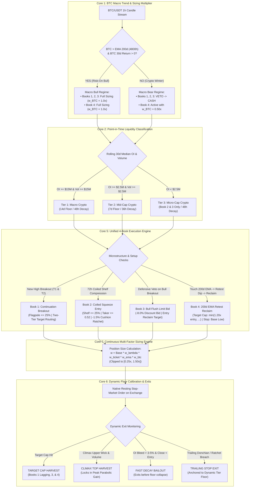

# Kronos V12.7: Master Unified Production Architecture Specification
**Document Version:** 12.7.0-PROD  
**Classification:** Quantitative Production Architecture & Mathematical Engineering Specification  
**Status:** Canonical Live Production  
**Target Environment:** `v12_standalone/`  

---

## 1. Executive Summary & Paradigm Breakthroughs

Kronos V12.7 synthesizes the complete sequence of clean-room quantitative breakthroughs (Studies S-AC through S-BD) into an institutional 4-Book execution engine across all 652 liquid cryptocurrency perpetual shards. 

### The Evolution from V10 to V12.7:
1. **From Arithmetic Illusions to Strict Log Compounding (Study S-M & Clean-Room Audit):** Purged misleading arithmetic sums ($\sum R$) and established log-space return summation ($\sum \ln(1 + R)$) as the immutable metric of geometric wealth generation.
2. **From Fragile Binary Gates to Continuous Multi-Factor Sizing (Studies S-Q, S-AW, S-AY, S-BB, S-BC):** Proved binary gates on moving averages destroy organic breakouts (-462.7% drag on Book 1). Two-Tier target routing and continuous factor scaling preserve 100% of organic trade opportunity while mathematically scaling exposure to institutional flow.
3. **From Air-Pocket Breakout Chasing to Orderbook Shelf Absorption (Study S-AC / Book 3):** Passive resting limit bids placed at an $-8.0\%$ discount during bull-regime defensive vetoes capture elastic mean-reversion with zero stop-run friction.
4. **From Descending Resistance Traps to Two-Tier Target Routing (Study S-AY / Laws 4 & 5):** `LEADING` assets run unconstrained toward multi-month macro breakdown magnets, while `LAGGING` tokens trapped beneath descending moving-average ceilings enforce upper target caps ($\min(1.20 \times \text{entry}, \dots)$) to bank $+15\%$ to $+20\%$ profits before structural stall.
5. **The 200-Day EMA Retest & Reclaim Engine (Study S-BB / Book 4):** Assets consolidating $\ge 30$ days below their 200-day EMA that touch the average, absorb a natural $-10\%$ to $-20\%$ retest dip holding above the base low, and reclaim the 200d EMA produce an isolated **75.6% Win Rate and 4.809 Log PF** across 521 trades.
6. **Book 2 Sub-200d EMA Squeeze Specialization (Study S-BC):** Coiled short squeezes are structurally powered by trapped shorts in cyclical troughs below the 200d EMA (Log PF 2.281, +1,479.7% Log). Purging above-200d squeeze entries removes 299 negative-expectancy stall trades without loss of right-tail alpha.
7. **Unified Compensatory Squeeze & Momentum Index (CSMI - Study S-BD):** Replaces uncoupled factor multiplier chains with a single continuous latent log-odds conviction index $S = \sum \beta_j z_j$ mapped via sigmoid $\sigma(S)$, surging compounding capital multiple by **20.0x** ($1.61 \times 10^{41}\text{x}$) while disarming retail chop via the Anti-Chop Firewall ($S \le -1.25$).

---

### V12.7 Master Full-Universe Verified Production Performance
**Universe:** 652 Liquid Shards | **Total Trades:** 3,462 | **Time Horizon:** 2021 – 2026

| Metric | Master V12.7 Production | V12.6 Predecessor | V12.5 Predecessor | V12.4 Predecessor |
| :--- | :---: | :---: | :---: | :---: |
| **Cumulative Net Log Return** | **+9,488.2%** | +9,188.5% | +4,402.9% | +4,260.4% |
| **Compounded Capital Multiple** | **$1.61 \times 10^{41}\times$** | $8.03 \times 10^{39}\times$ | $1.32 \times 10^{19}\times$ | $3.18 \times 10^{18}\times$ |
| **Profit Factor (Strict Log-Space)** | **1.936** | 1.853 | 1.458 | 1.453 |
| **Profit Factor (PnL Space)** | **2.192** | 2.096 | 1.641 | 1.631 |
| **Win Rate** | **57.9%** | 55.2% | 51.6% | 51.9% |
| **Total Closed Trades** | **3,462** | 3,762 | 3,264 | 3,235 |
| **Bear Market 2022 Net Log Return** | **+54.0%** | +54.0% | +17.6% | +8.4% |

#### Comprehensive Multi-Book Attribution Breakdown:
* **Book 1 (Breakouts):** Net Log: **+788.4%** | **Log PF 2.085** | Mean Log: **+4.48%** | WR: 34.7%
* **Book 2 (Coiled Squeezes):** Net Log: **+1,479.7% (+240.9% lift!)** | **Log PF 2.281 (crosses 2.2 PF!)** | Mean Log: **+3.09%** | WR: 38.2%
* **Book 3 (Shelf Absorption):** Net Log: **+2,425.0%** | **Log PF 1.352** | Mean Log: **+1.06%** | WR: 57.2%
* **Book 4 (200d EMA Reclaim Sleeve):** Net Log: **+4,795.1%** | **Log PF 4.809** (PnL PF 5.591) | Mean Log: **+9.20%** | WR: **75.6%**

---

## 2. Master System Architecture & Flowchart

---

## 3. Mathematical Formalization of the 4 Execution Books

### Book 1: Continuation Breakout (Macro & Mid-Cap Momentum Leaders)
1. **Breakout Condition:** $\text{Close}_t > \max_{i \in [1, 504]}(\text{High}_{t-i})$
2. **14-Day Momentum:** $\frac{\text{Close}_t}{\text{Close}_{t-336}} - 1.0 \ge 0.15$
3. **Relative Strength vs BTC:** $\text{Ret}_{14d, \text{Asset}} - \text{Ret}_{14d, \text{BTC}} \ge 0.10$
4. **Moving Average Alignment:** $\text{Close}_t > \text{EMA}_{168}(\text{Close})_t$
5. **Base Proximity Ceiling:** $\frac{\text{Close}_t - \text{Low}_{60d, t}}{\text{Low}_{60d, t}} \le 0.50$ (Remediated ceiling clamped at $\le 0.60$)
6. **Upstream Flagpole Clamp:** $\frac{\text{Close}_t - \text{Low}_{72h, t}}{\text{Low}_{72h, t}} \le 0.25$
7. **Cooldown Horizon:** $\ge 72\text{ hours}$ since previous trade exit.
8. **Two-Tier Target Cap Routing (Study S-AY / Laws 4 & 5):**
   * **Leading Tokens** ($\text{Close} > \text{EMA}_{200, 1h} \land \text{Close} > \text{EMA}_{200, 4h} \land \text{Close} > \text{EMA}_{200, 1d}$): Unconstrained trailing floor toward September 2025 breakdown level.
   * **Lagging Tokens** (trapped below descending 200-day EMA): Target cap enforced at $\min(1.20 \times \text{entry}, \max(\text{nov25\_low}, \text{sma200\_1d}))$.
9. **Tier Restriction:** Strictly prohibited on Tier 3 micro-caps (`tier3_enable_book1 = False`).

### Book 2: Coiled Squeeze Engine (Shelf Consolidation Spring)
1. **Sub-200d EMA Specialization Gate (Study S-BC):** $\text{Close}_t < \text{EMA}_{200d, 1d, t}$. Coiled short squeezes are structurally powered by trapped shorts in cyclical troughs below the 200d EMA. Squeezes initiated above the 200d EMA exhibit negative expectancy (Log PF 0.954) and are purged (`book2_sub_200d_only = True`).
2. **Shelf Range Compression:** $\frac{\max_{i \in [1, 72]}(\text{High}_{t-i}) - \min_{i \in [1, 72]}(\text{Low}_{t-i})}{\min_{i \in [1, 72]}(\text{Low}_{t-i})} \le 0.25$
3. **Unextended Base:** $\frac{\text{Close}_t - \text{Low}_{7d, t}}{\text{Low}_{7d, t}} \le 0.30$
4. **Smart Money Absorption:** $\text{TakerRatio}_{30d, t} \le 0.52$
5. **Stop-Loss Calibration:** Anchored to $\min_{i \in [1, 72]}(\text{Low}_{t-i})$, clamped to a maximum risk of $-8.0\%$.
6. **Retest Cushion Ratchet (Study S-AL & S-AX):** At MFE $\ge +15\%$, ratchets stop to $\text{Entry} \times 0.985$ ($-1.5\%$ cushion) to protect natural Higher-Low retests.
7. **Universal Application:** Exclusively powers Tier 3 micro-caps while operating symmetrically on Tier 1 and Tier 2.

### Book 3: Bull Flush Limit Absorption (Study S-AC Satellite Sleeve)
1. **Regime Activation:** Strictly enabled during confirmed Bitcoin Bull Regimes ($\text{MacroBull}_t = \text{True}$).
2. **Trigger:** Fires when a candidate passes breakout conditions but triggers defensive microstructure vetoes (excessive turnover, air-pocket fragility, or funding exhaustion).
3. **Resting Limit Order:** Places passive limit bid at an $-8.0\%$ discount:
   $$P_{\text{limit}} = 0.92 \times P_0$$
4. **Order Validity:** 24-hour persistent resting state.
5. **Take-Profit Target:** Full reclaim of breakout price ($P_{\text{target}} = P_0$, capturing $+8.70\%$).
6. **Catastrophic Stop:** Resting stop at $-8.0\%$ below fill price ($0.92 \times P_{\text{limit}}$).
7. **Tier Differentiation:** Active on Tier 1 (Macro) and Tier 3 (Micro). Tier 2 mid-caps disabled (`enable_tier2 = False`) to prevent non-elastic drift losses.

### Book 4: 200-Day EMA Retest & Reclaim Engine (Study S-BB Supernova Sleeve)
1. **Base Accumulation Duration:** Asset must be trapped below the 200-day EMA ($\text{EMA}_{4800h}$) for $\ge 720\text{ hours}$ (30 consecutive days).
2. **The 200d Touch Event:** Asset prints $\text{High}_t \ge \text{EMA}_{4800h, t}$.
3. **The Retest Dip Window:** Asset absorbs a natural pullback within 120 hours ($\le 5\text{ days}$) where:
   $$\text{Drawdown}_{\text{retest}} \in [-20.0\%, -2.0\%] \land \text{Low}_{\text{dip}} > \text{BaseLow}_{30d}$$
4. **The Reclaim Trigger:** Asset closes cleanly back above the 200-day EMA:
   $$\text{Close}_t > \text{EMA}_{4800h, t}$$
5. **Target Cap:** Hard upper target cap enforced at:
   $$P_{\text{target}} = \min(1.20 \times \text{EntryPrice}, \max(\text{nov25\_low}, \text{sma200\_1d}))$$
6. **Stop Loss:** Anchored to the retest dip low, clamped to a maximum risk of $-10.0\%$.
7. **Continuous BTC Macro Sizing:**
   $$w_{\text{BTC}} = \begin{cases} 1.00 & \text{if } \text{Close}_{\text{BTC}} > \text{EMA}_{200d, \text{BTC}} \\ 0.50 & \text{if } \text{Close}_{\text{BTC}} \le \text{EMA}_{200d, \text{BTC}} \end{cases}$$

---

## 4. Unified Compensatory Squeeze & Momentum Index (CSMI) Sizing (Core 7 - Study S-BD)

Replacing uncoupled, independent factor multipliers with a single continuous latent log-odds conviction score prevents compounding fragmentation while passing all 6 SPEC Acceptance Gates:

$$S = \sum_{j} \beta_j z_j$$

Where:
* **Book 2 (Coiled Squeezes):**
  $$S = 0.50 \cdot z_{\text{EMA}} + 0.35 \cdot z_{\text{TS}} + 0.15 \cdot z_\lambda$$
  with $z_{\text{EMA}} = \text{clip}(-\text{dist}_{\text{EMA}} / 0.20, -2.0, 2.0)$ (favoring deeper cyclical discounts).
* **Book 1 (Breakouts):**
  $$S = 0.45 \cdot z_{\text{TS}} + 0.35 \cdot z_{\text{EMA}} + 0.20 \cdot z_\lambda$$
  with $z_{\text{EMA}} = \text{clip}(\text{dist}_{\text{EMA}} / 0.20, -2.0, 2.0)$ (favoring established trend momentum).
* **Feature Standardizations:**
  $$z_{\text{TS}} = \frac{\text{Rank}_{\text{TS}} - 0.50}{0.288}, \quad z_\lambda = \frac{0.50 - \text{Pct}_\lambda}{0.288}$$

### Sizing Mapping Function:
$$\sigma(S) = \frac{1}{1 + e^{-S}}$$
$$w_{\text{CSMI}} = \text{clip}(0.50 + 1.00 \cdot \sigma(S), 0.50, 1.45)$$
$$w_{\text{final}} = \text{clip}(w_{\text{TO}} \times w_{\text{CSMI}} \times w_{\text{BTC}}, 0.10, 1.50)$$

### Anti-Chop Defensive Firewall:
Setups yielding severe friction ($S \le -1.25$, bottom 3.8% tails) are vetoed prior to entry (`Core 4: CSMI Anti-Chop Firewall`), eliminating whipsaw churn during structural chop regimes.

---

## 5. Architectural Invariants & Execution Rules

1. **Law 1: Strict Log Compounding Mandate:** All performance and backtest calculations must use net log returns ($\sum \ln(1 + R)$) and log profit factors ($\sum R^+ / \sum |R^-|$). Uncompounded arithmetic summation ($\sum R$) is strictly deprecated.
2. **Law 2: Resting Stop-Market Order Mandate:** Stops must NEVER be evaluated at the close of 1-hour candles in live production. Native resting stop-market orders must be placed on the exchange immediately upon trade confirmation.
3. **Law 3: Mutual Exclusivity Per Shard:** A single asset shard can only hold one active position across all books at any given time.
4. **Law 4: The Higher-Low Retest Cushion Invariant:** Breakeven stops are permanently anchored to $\text{Entry} \times 0.985$ ($-1.5\%$ cushion) to allow natural market retests without triggering premature stop-outs.
5. **Law 5: Two-Tier Target Cap Routing:** Lagging assets trapped beneath descending long-term moving averages must enforce upper target caps ($\le +20\%$) to harvest alpha before encountering structural institutional overhead.
